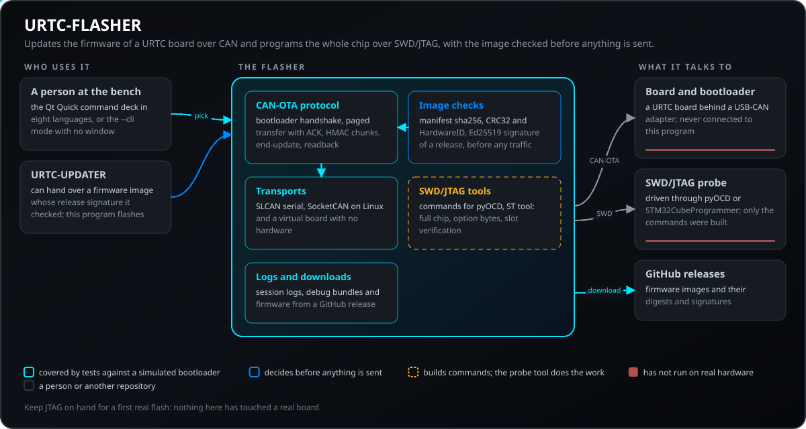
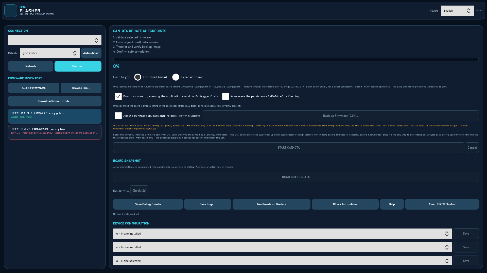
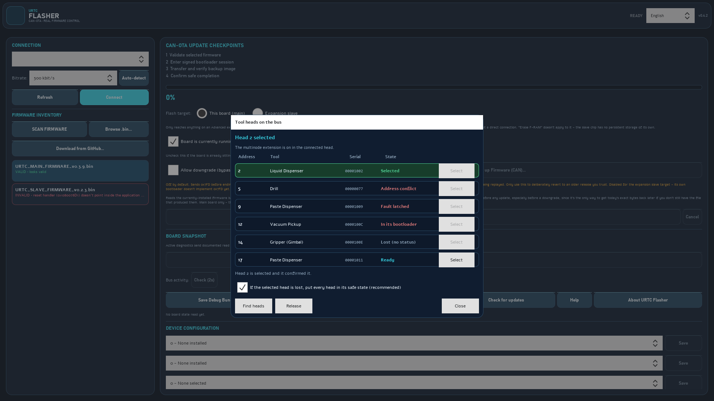
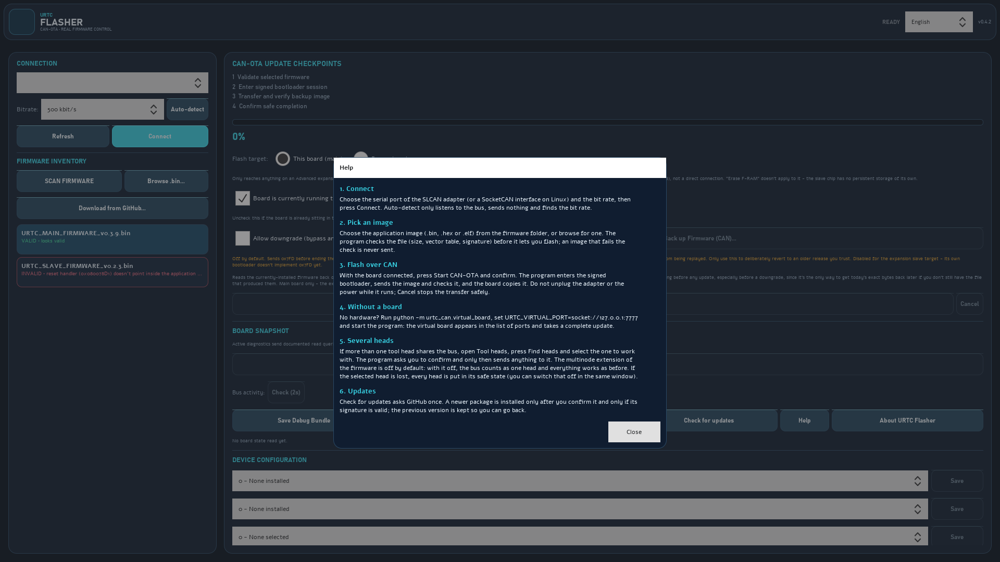
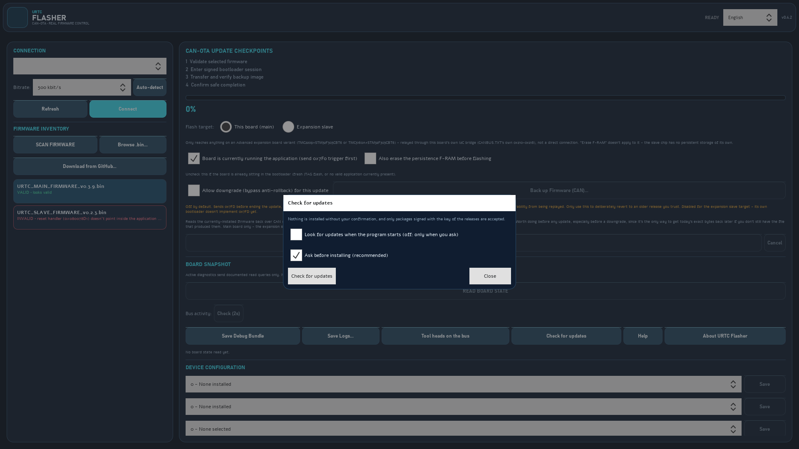
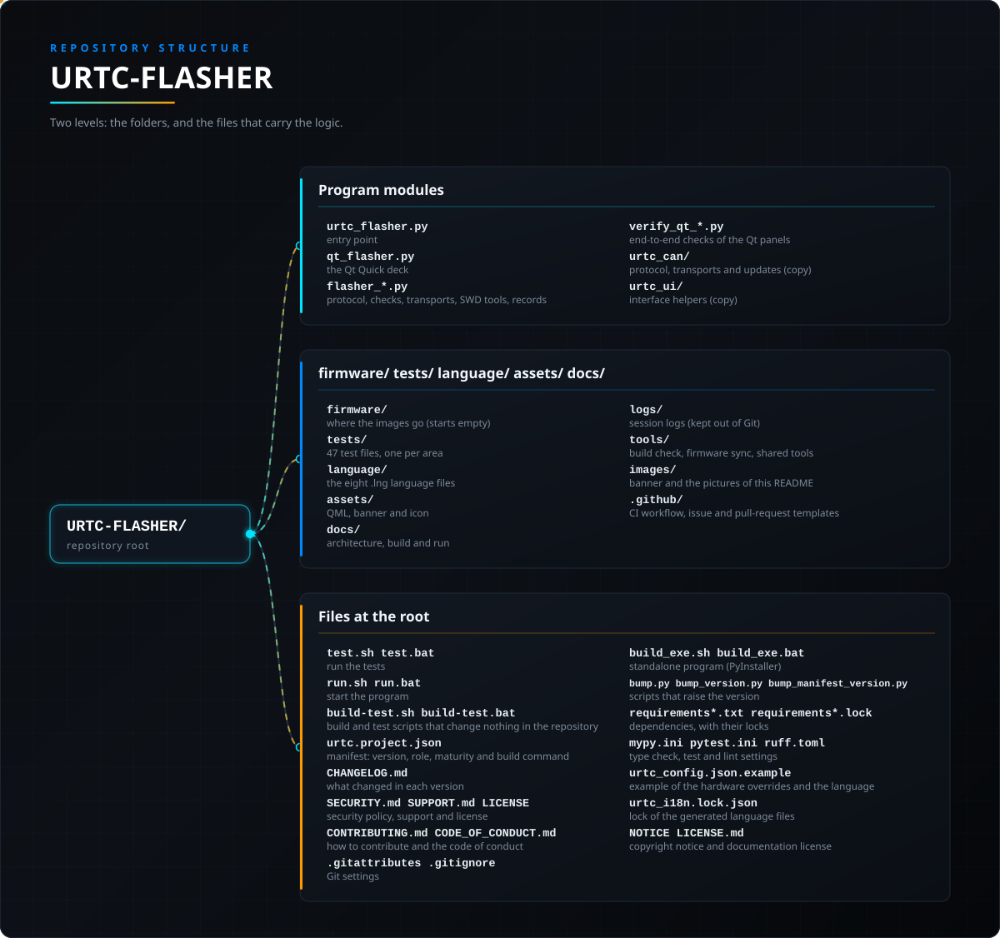

<p align="center">
  
</p>

# URTC Flasher (Windows / Linux)

<p align="center">
  <a href="README.md">🇺🇸 English</a> |
  <a href="README_spa.md">🇪🇸 Español</a> |
  <a href="README_fra.md">🇫🇷 Français</a> |
  <a href="README_ita.md">🇮🇹 Italiano</a> |
  <a href="README_deu.md">🇩🇪 Deutsch</a> |
  <a href="README_zho.md">🇨🇳 简体中文</a> |
  <a href="README_jpn.md">🇯🇵 日本語</a> |
  🇵🇹 <b>Português</b>
</p>

### Atualiza o firmware de uma placa URTC por CAN (CAN-OTA) e programa o chip inteiro por SWD/JTAG, em Windows e Linux

<p align="center">
  
  
  
  
  
</p>

---

**Verificação de honestidade - o que realmente corre hoje:** `tests/` contém 51 ficheiros pytest (602 testes: todos passam; 73 deles são ignorados sem PySide6) - o protocolo CAN-OTA contra um transporte `MockCAN` real (`flasher_transports.py`) que reproduz uma sequência completa de bootloader simulado (start/erase/receive, dados de página + PAGE_ACK, blocos HMAC, end-update com um sucesso real ou um `VERIFY_FAIL_REASON` específico), as regras de assinatura (assinatura publicada enviada sem qualquer chave, imagem sem assinatura recusada, discrepância de sha256 do manifesto recusada antes de qualquer tráfego no barramento), as verificações de integridade da imagem e o `firmware/` incluído contra os seus manifestos. O GitHub Actions (`.github/workflows/ci.yml`) corre esta suite em cada push, e `tools/build_test.py` corre-a em `build-test.sh`/`.bat`. Executa ainda `ruff check` e `python -m mypy` (uma verificação de tipos do programa e das cópias do código partilhado). Os três scripts `verify_qt_*.py` na raiz do repositório são verificações reais de ponta a ponta mantidas fora do pytest (precisam de um loop de eventos Qt real; execute-os com `QT_QPA_PLATFORM=offscreen python verify_qt_*.py`); `verify_qt_swd_full_chip_flash.py` apenas constrói os comandos `PyOCDCLI`/`CubeProgrammerCLI` com `dry_run=True`. Nada disto foi executado contra uma placa real com hardware real neste ambiente. Consulte `CHANGELOG.md` para saber exatamente o que foi entregue até agora. O bootloader simulado (`MockCAN`) é apenas um modelo escrito a partir da descrição do protocolo: reproduz os ACK de página, a última página parcial e as tramas de leitura, mas não é o bootloader real, pelo que uma execução de testes a verde não substitui um ensaio numa placa real (a imagem oficial de 73476 bytes não se conseguia instalar e a última trama de uma cópia perdia-se enquanto os testes passavam, precisamente porque a simulação era mais permissiva do que o bootloader real).

---

> **Estado de segurança (safety e security):** este ecossistema não é um sistema de segurança certificado e ainda não existe nenhuma placa URTC montada. Os bootloaders verificam as imagens de firmware com CRC32 e um HMAC-SHA256 de chave partilhada, não com uma assinatura assimétrica (prevista); as imagens de aplicação publicadas estão assinadas com a chave pública de desenvolvimento (`signing_key_kind: dev`), pelo que qualquer pessoa pode produzir uma imagem que o bootloader aceita; nada foi transmitido a uma placa real. Leia a [base de segurança](https://github.com/JuanenRac/URTC-DOCS/blob/main/docs/SECURITY_BASELINE.md) e o [modelo de ameaças](https://github.com/JuanenRac/URTC-DOCS/blob/main/docs/THREAT_MODEL.md) antes de confiar em qualquer afirmação aqui para a segurança de uma pessoa.

## 📋 Num relance

| | |
|---|---|
| Versão | `0.4.4` |
| Maturidade | Funcional |
| Testes | 602 (`python -m pytest tests -q`) |
| Tecnologia | Python / PySide6 / Qt Quick / CAN-OTA / SWD/JTAG |
| Destino | O PC de quem o usa |
| Em hardware real | Só simulado: testado com emuladores, dublês de teste ou simuladores; não há registo de execução em hardware real para esta versão |

**Ir para:** [Visão geral](#-visão-geral) · [Arquitetura](#-arquitetura) · [Funcionalidades](#-funcionalidades) · [Segurança](#-segurança-e-proteção) · [Interfaces](#-interfaces) · [Configuração](#-configuração) · [Início rápido](#-início-rápido) · [Testes](#-testes) · [Estrutura](#-estrutura-do-repositório) · [Relacionados](#-projetos-relacionados)

<!-- urtc-section:status_flasher -->
## 🚦 Estado do projeto

🟢 feito e verificado · 🟡 funciona, com limites conhecidos · 🟠 a meio ou por verificar · 🔴 por fazer ou a não funcionar. Nada é verde se nunca correu em hardware real.

| Parte | Estado | O que o repositório consegue demonstrar |
| --- | :---: | --- |
| Software | 🟡 | Funciona num PC e contra o simulador; nunca foi usado com uma placa real. |
| Interface | 🟡 | A janela funciona e é verificada contra uma placa simulada; não foi experimentada com um adaptador real. |
| Testes | 🟢 | A bateria de testes passa na CI em cada envio. |
| Hardware real | 🟠 | Ainda não correu numa placa real: o ensaio de bancada continua pendente. |
| Segurança | 🟡 | As versões são assinadas com Ed25519 e verificadas antes de usar; o tratamento das chaves não foi revisto por mais ninguém. |
| Documentação | 🟡 | README em oito línguas e documentos de referência; as traduções não foram revistas por falantes nativos. |

<!-- /urtc-section:status_flasher -->

## 🎯 Visão geral

Uma pequena ferramenta GUI multiplataforma para atualizar o firmware das
placas URTC através do barramento CAN. Implementa o protocolo exato do
bootloader descrito em `docs/CANBUS.TXT` (no repositório irmão
[URTC](https://github.com/JuanenRac/URTC) contra o qual esta ferramenta é
implementada - consulte "Projetos Relacionados" perto do fim deste documento;
todas as outras referências a `docs/*.TXT` neste README apontam também para
lá): a verificação do HardwareID, o HMAC-SHA256 de chave partilhada (não uma assinatura assimétrica), o fluxo de
atualização golden-image com slot de backup, o progresso em direto através das
mensagens de heartbeat do bootloader, e uma consulta de versão (se a aplicação
*ou* o bootloader desta placa se identifica através do CAN) para que possa ver
o que está atualmente instalado antes de decidir o que escrever.

**Procurar atualizações.** O botão «Procurar atualizações» pergunta ao GitHub uma vez pela versão mais recente e só propõe a transferência se esta tiver um pacote para este sistema mais recente do que a versão instalada. O pacote só é aceite se o SHA-256 e a assinatura Ed25519 (a chave das versões, fixada no programa) forem válidos; só é instalado depois de o confirmar, nunca durante uma transferência, e a versão anterior é guardada para poder voltar atrás (e é reposta sozinha se a nova não arrancar). Nada é verificado nem instalado por si só: a verificação ao abrir é uma opção, desligada por defeito, e a confirmação só se desliga na mesma janela, depois de um aviso.

Duas formas de comunicar com a placa, ambas a falar o mesmo protocolo por baixo:

- **Serial / SLCAN** — funciona em Windows e Linux. Precisa de um adaptador
  USB-CAN com firmware SLCAN, ligado como porta série virtual.
  - Sem adaptador nem hardware, uma placa virtual faz as vezes: execute `python -m urtc_can.virtual_board`, indique o seu endereço na variável de ambiente `URTC_VIRTUAL_PORT` (por exemplo `socket://127.0.0.1:7777`) antes de iniciar o programa, ou passe-o a `--port` na linha de comandos. Aparece na lista de portas e responde como uma placa, aplicação e bootloader.
- **SocketCAN** — **apenas Linux**, e só é mostrado na UI da ferramenta em
  Linux. Comunica diretamente com uma interface de rede `can0`/`slcan0` do
  kernel. Se o seu adaptador já corre firmware `gs_usb`/candleLight (a maioria
  das placas CANable fá-lo de origem), este caminho **não precisa de qualquer
  reflash do adaptador** — o próprio driver do Linux trata disso nativamente.

## 🧩 Papel no URTC

O URTC-FLASHER é o programa que põe firmware numa placa URTC. Fala o protocolo do bootloader do URTC (`docs/CANBUS.TXT` desse repositório) através de um adaptador USB-CAN, como porta série SLCAN ou como SocketCAN em Linux: a verificação do HardwareID, blocos HMAC-SHA256 de chave partilhada, o fluxo de imagem dourada com ranhura de reserva e uma consulta de versão para ver o que está instalado antes de decidir o que gravar. Para uma placa sem bootloader que funcione, ou para programar o chip inteiro, prepara os comandos SWD/JTAG do pyOCD ou do STM32CubeProgrammer. É o companheiro de atualização do URTC-TESTER, partilha com ele o código CAN através do URTC-COMMON, e o URTC-UPDATER pode entregar-lhe uma imagem de firmware cuja assinatura de release já foi verificada.

## 🏛️ Arquitetura

<p align="center">
  
</p>

Como as partes deste repositório se encaixam: quem o usa, o que contém e de que depende. A imagem é desenhada a partir de `docs/architecture.json` e verificada com o código.

<!-- urtc-section:updates -->
### Como se atualiza

Este programa pode procurar uma versão mais recente de si próprio: o botão «Procurar atualizações» pergunta uma vez ao GitHub e só propõe um pacote assinado se for para o seu sistema e mais recente. Nada é verificado nem instalado por si só, a não ser que ative a verificação, e uma atualização precisa da sua confirmação. O pacote tem de coincidir com o seu SHA-256 e com a assinatura da chave das versões fixada no programa; a versão anterior é guardada e reposta sozinha se a nova não arrancar. `urtc-updater --cli package list|check|install|rollback` faz o mesmo na linha de comandos para o flasher e o tester, e `install --file` funciona sem rede.
<!-- /urtc-section:updates -->

## 🖼️ Capturas de ecrã

<!-- urtc-shots -->
Capturadas a 1920×1080 numa bancada de testes, com dados de exemplo e sem qualquer instalação real por trás.

<table>
<tr>
<td width="50%" valign="top"><br><sub>A janela ao abrir: a ligação, o inventário de firmware, os quatro pontos de controlo de uma atualização CAN-OTA e a configuração do dispositivo.</sub></td>
<td width="50%" valign="top"><br><sub>Cabeças de ferramenta no barramento: um barramento modelado com seis cabeças, cada uma num estado possível (selecionada, conflito de endereço, falha retida, no bootloader, perdida e pronta).</sub></td>
</tr>
<tr>
<td width="50%" valign="top"><br><sub>A janela de Ajuda: os passos para utilizar o programa, escritos no idioma da janela.</sub></td>
<td width="50%" valign="top"><br><sub>A janela de atualizações: um pacote assinado mais recente só é instalado depois de o confirmar.</sub></td>
</tr>
</table>
<!-- /urtc-shots -->

Estas imagens são a janela real, desenhada sem ecrã tal como abre (nada ligado, nada enviado). O guia percorre o painel, a janela de Ajuda e a de atualização.

[Guia com imagens](docs/WINDOW_GUIDE.md)

## ✨ Funcionalidades

### Verificar o que está atualmente instalado

> No painel Qt Quick, as portas dos dois transportes (adaptadores série e, em Linux, interfaces SocketCAN) estão numa só lista, e as consultas desta secção são feitas por **LER ESTADO DA PLACA**, que pede de uma vez a versão, os contadores de erro CAN, o tipo de placa de expansão, a variante MLX9064x e a informação do periférico e os mostra no instantâneo da placa. Os guardados da secção de configuração do dispositivo escrevem os valores.

Se estiver em Linux e o SocketCAN estiver disponível, verá uma escolha de
**Transport** no topo - escolha Serial/SLCAN ou SocketCAN antes de ligar. Em
Windows esta linha nem sequer aparece; Serial/SLCAN é a única opção.

Clique em **Connect**, e a ferramenta pergunta automaticamente à placa o que
está atualmente a correr (CAN ID `0x7F8` → `0x7F9` - consulte
`docs/CANBUS.TXT`). Isto funciona quer a placa esteja a correr a sua aplicação
normalmente *quer* esteja parada no bootloader, pelo que não precisa de
provocar um reset só para descobrir. Clique em **Query** a qualquer momento
depois para verificar novamente (útil logo após a conclusão de uma gravação,
para confirmar que a nova versão realmente ficou).

**Quando é o próprio bootloader que responde** (placa parada no bootloader, sem
correr a sua aplicação), reporta também a sua própria versão - algo separado
da versão da aplicação instalada, acompanhada através dos seus próprios
`BOOTLOADER_VERSION_MAJOR/MINOR/PATCH` em `bootloader_common.h` e enviada como
uma segunda trama (`0x7FA`) logo a seguir a `0x7F9`. A aplicação em execução
nunca a envia - não tem forma de saber a versão de um bootloader atualmente
gravado a não ser perguntando ao próprio bootloader, pelo que isto só aparece
quando a placa está efetivamente parada aí (logo após `0x7F0`, ou num arranque
limpo antes de saltar para a aplicação).

**O número de patch.** Uma placa com firmware 0.3.5 ou posterior envia
também o número de patch da aplicação instalada (trama `0x7E9`, logo a
seguir a `0x7F9`), pelo que a janela e o registo mostram o
`maior.menor.patch` completo (por exemplo `v0.3.5`) em vez de
`maior.menor`; o patch de uma imagem é a terceira parte da versão do seu
manifesto. Antes de uma atualização, o registo mostra `instalada -> nova`
nesse formato, e o patch só entra no aviso "mais antiga do que a
instalada" quando ambos os lados o têm. Uma placa anterior ao patch
responde sem ele e é mostrada exatamente como antes. Quando o bootloader
anuncia (indicador na mesma trama) que lê o patch, a trama de fim de
atualização transporta-o no byte alto do campo menor; qualquer outro
bootloader, e qualquer imagem sem patch, recebem a trama de dois números
inalterada. A resposta de versão do escravo de expansão (`0x218`) tem a
mesma extensão opcional. Isto segue a descrição do protocolo e só foi
testado com o simulador; não foi experimentado numa placa real.

O que verá:

- **`v0.2 (application, HardwareID 0x0303CC01)`** - caso normal, aplicação em
  execução, tudo coincide.
- **`Bootloader running, no valid firmware currently installed, bootloader
  v0.1.2`** - a placa está presa no bootloader sem nada para onde saltar
  (chip em branco, ou todas as verificações do slot principal falharam). Esta
  é exatamente a situação que esta ferramenta existe para resolver - grave.
  A versão do bootloader mostrada aqui é a do próprio bootloader, sem relação
  com a versão da aplicação cujas verificações falharam.
- **`⚠ HardwareID mismatch!`** mostrado a vermelho - algo respondeu, mas o seu
  HardwareID não coincide com o que esta ferramenta espera. Não grave sem
  perceber primeiro porquê; o bootloader rejeitaria a atualização de qualquer
  forma, mas uma discrepância aqui pode também significar que está a apontar
  para a placa completamente errada.
- **Sem resposta** (vermelho) - placa sem resposta, bitrate errado, ou não
  realmente ligada. Verifique a ligação física e, no caminho SocketCAN, que a
  interface está realmente ativa (`ip link show`).

**Placa de expansão:** uma lista pendente e um par Query/Save separados,
mesmo abaixo da verificação de versão. Lê e define qual das 7 configurações
possíveis de `CONN_EXPANSION` (nenhuma, ou uma de 6 variantes reais - consulte
`EXPANSION.TXT`) está fisicamente instalada, através do CAN
(`0x1A0`/`0x1A1`). Não existe forma elétrica de a placa detetar isto por si,
pelo que tem de lhe ser indicado - isto vive aqui (e não apenas no `URTC
Tester`) uma vez que é um passo único de configuração de hardware mais
naturalmente feito juntamente com uma atualização de firmware. **Save** pede
primeiro confirmação, uma vez que isto persiste entre ciclos de alimentação
até ser explicitamente alterado outra vez.

**Variante do sensor MLX9064x:** com a mesma forma que o controlo da placa de
expansão logo acima - uma lista pendente e um par Query/Save que lê/define qual
dos 3 sensores térmicos da família MLX9064x (ou nenhum) está realmente
montado, através do CAN (`0x1A6`/`0x1A7` - consulte `CANBUS.TXT`). Só tem
significado quando a placa de expansão acima está definida para uma variante
Advanced ou para Basic+MLX9064x; o próprio firmware da placa ignora
totalmente esta definição em qualquer outro tipo de placa de expansão. "None
installed" (o valor seguro por defeito) deliberadamente não recorre a assumir
MLX90640 - uma placa com um MLX90640 real ligado precisa que isto seja
definido explicitamente, uma vez, da mesma forma que o próprio tipo de placa de
expansão.

### Gravação

1. **Connect**: escolha Serial/SLCAN ou SocketCAN (apenas Linux), depois a
   porta/interface, e clique em Connect. Para Serial/SLCAN isto abre o canal
   CAN a 500 kbit/s (a velocidade fixa do barramento do URTC); para SocketCAN
   espera-se que a interface já esteja a esse bitrate (passo 1 acima) - esta
   ferramenta não o define. Em ambos os casos, a versão atual é consultada
   automaticamente - consulte a secção 4 acima.
2. **Escolha um alvo de gravação**: "This board (main)" ou "Expansion slave" -
   por defeito a placa principal, o caso de longe mais comum. A opção slave
   só alcança alguma coisa numa variante de placa de expansão Advanced
   (TMC2209+STM32F303CBT6 ou TMC5160A+STM32F303CBT6) - a atualização é
   retransmitida através da própria ponte I2C da placa principal para o chip
   slave (os próprios `0x210`-`0x219` de `CANBUS.TXT`), não por uma ligação
   física separada. "Erase F-RAM before flashing" (passo 4 abaixo) desativa-se
   automaticamente quando Slave é escolhido - o chip slave não tem F-RAM
   própria para apagar.
3. **Selecione o firmware**: escolha da lista detetada, ou use Browse -
   consulte a secção 3 acima para saber exatamente como funcionam a deteção e
   a validação.
4. **Flash**:
   - Deixe "Board is currently running the application" marcado se a placa
     estiver ligada e a funcionar normalmente - a ferramenta envia primeiro o
     trigger de payload mágico `0x7F0` (ou `0x210`, retransmitido ao slave, se
     Slave for o alvo selecionado), que desliga em segurança todos os
     atuadores antes de reiniciar para o bootloader.
   - Desmarque-o se a placa já estiver parada no bootloader (logo após uma
     gravação JTAG nova, ou se a verificação de versão acima mostrou "no
     valid firmware currently installed").
   - Clique em **Flash Firmware** e confirme - o diálogo de confirmação indica
     qual o alvo que está prestes a gravar, por isso confirme duas vezes que
     corresponde ao que realmente pretendia selecionar. O registo mostra cada
     passo do protocolo; a barra de progresso acompanha o progresso da escrita
     página a página durante a transferência, e depois o progresso da cópia
     durante a cópia final do backup para o slot principal.

Se a verificação falhar em qualquer ponto (CRC32, HMAC, ou discrepância de
HardwareID), o slot principal do bootloader nunca é tocado - a placa continua a
correr o firmware que já tinha. É sempre seguro simplesmente tentar outra vez.

**Back up Firmware (CAN)**: lê de volta, através do barramento e sem
modificações, o firmware atualmente instalado e guarda-o como um ficheiro
`.bin` - o equivalente CAN do próprio "back up entire flash before erasing" da
secção SWD (secção 6 abaixo), pela mesma razão. Vale a pena fazê-lo antes de
qualquer atualização, especialmente antes de um downgrade deliberado (abaixo),
uma vez que é a única forma de recuperar mais tarde os bytes exatos de hoje se
já não tiver o ficheiro que os produziu. Apenas placa principal, e apenas
enquanto a placa está efetivamente parada no bootloader - requer um bootloader
que implemente `0x7FE`/`0x7FF` (consulte `docs/CANBUS.TXT`); um mais antigo
simplesmente nunca responde, o que se manifesta como um timeout claro em vez
de um ficheiro silenciosamente vazio. Na prática, isto significa que a cópia funciona numa placa sem aplicação válida ou que ficou a meio de uma atualização: com uma aplicação válida o bootloader salta para ela cerca de 600 ms depois do reset, a menos que chegue uma trama de início de atualização (`0x7F1`), e esta ferramenta não tem nenhum botão que mantenha o bootloader à espera (isso exigiria uma alteração no bootloader). Para uma placa a funcionar normalmente, faça a cópia da flash por SWD/JTAG (secção 6).

**Avisos de versão e de assinatura**: antes da transferência a ferramenta pergunta à placa o que está instalado e regista "instalada vX.Y -> nova vA.B"; se a versão nova for mais antiga, avisa que o bootloader a recusará a menos que o downgrade seja permitido e sugere fazer primeiro uma cópia de segurança. Uma imagem cujo manifesto diz estar assinada com a chave de desenvolvimento PÚBLICA (as imagens oficiais incluídas estão) mostra um aviso a vermelho por baixo do nome do ficheiro; defina `"require_production_signature": true` em `urtc_config.json` para recusar totalmente essas imagens. Quando a placa responde a partir do bootloader sem firmware válido, é selecionada a imagem oficial mais recente da placa principal encontrada em `firmware/`, para a verificar e gravar. Depois de cada atualização bem-sucedida é escrito um pequeno relatório (`logs/urtc_update_report_*.json`: versão da ferramenta, operador, nome, tamanho e SHA-256 da imagem, versões antes e depois); leva o seu próprio SHA-256 para que uma edição se note, mas não é uma assinatura.

**Instalar deliberadamente uma versão mais antiga**: o bootloader normalmente
rejeita uma imagem validamente assinada se esta declarar uma versão mais antiga
do que a já instalada (motivo de falha de verificação "rollback rejected") -
isto impede que uma versão com uma vulnerabilidade entretanto descoberta seja
reintroduzida. Se precisar genuinamente de reverter para uma versão mais
antiga e ainda de confiança, marque **"Allow downgrade (bypass anti-rollback)
for this update"** (Target: apenas placa principal) antes de gravar - aparece
um segundo diálogo de confirmação, uma vez que isto contorna deliberadamente
uma verificação de segurança. Isto continua a enviar a imagem antiga completa
através da transferência normal, apenas levanta a verificação da ordem de
versões para essa única tentativa (`0x7FD` - consulte `docs/CANBUS.TXT`); o
número de versão reportado à placa vem do próprio `.manifest.json` do
ficheiro quando existe um ao lado dele (consulte a secção 3 acima), recorrendo
em caso contrário à versão atualmente configurada desta própria ferramenta,
registado claramente em qualquer dos casos para que nunca seja um palpite
silencioso.

### Programar o chip completo através de SWD/JTAG (avançado)

O painel "Program complete chip via SWD/JTAG (advanced)" do separador **SWD/JTAG
Programming** faz uma gravação completa de bring-up - apaga o chip inteiro
(mass-erase), e depois escreve de novo as imagens do bootloader e da
aplicação, nos endereços reais do chip que correspondem à seleção de **Target
chip** (ver abaixo). Isto é um **tipo de operação diferente** das secções 1-5
acima:

|  | Atualização CAN OTA (secções 1-5) | SWD/JTAG de chip completo (secção 6) |
|---|---|---|
| Autorrecuperação se interrompida | Sim - o slot de backup golden-image garante que o firmware em execução sobrevive | Não - não corre nada até ser reprogramado |
| Recuperável | Automaticamente, sem necessidade de ação | Sim - basta voltar a ligar e gravar de novo por SWD; a porta de depuração não depende do conteúdo da flash. Só um verdadeiro bloqueio permanente (byte de opção RDP2) o impediria, e nada nesta ferramenta define bytes de opção |
| Toca no bootloader | Nunca | Sim, por design |
| Precisa de | Um adaptador USB-CAN | Uma sonda SWD/JTAG (ST-Link ou semelhante) |
| Uso típico | Atualizações de firmware de rotina | Primeiro bring-up num chip em branco, ou recuperar uma placa inutilizada (bricked) |

**Target chip:** "This board (main)" ou "Expansion slave" - as mesmas 2 opções
do seletor do próprio separador CAN-OTA, mas uma escolha genuinamente separada
aqui: o SWD/JTAG precisa de uma sonda fisicamente ligada ao chip para o qual
isto está definido, uma vez que não há uma ponte (ao contrário do CAN-OTA) que
permita a uma ligação alcançar ambos. Mudar isto altera automaticamente os
endereços de flash usados:

| | Placa principal (STM32F303CC) | Slave de expansão (STM32F303CBT6) |
|---|---|---|
| Endereço do bootloader | `0x08000000` (região de 32K) | `0x08000000` (região de 18K) |
| Endereço da aplicação | `0x08008000` (região de 112K) | `0x08005000` (região de 54K) |
| String de alvo pyOCD | `stm32f303cc` | `stm32f303cb` |

Ambas as strings de alvo acima são a melhor estimativa do próprio projeto para
o nome real do alvo pyOCD de cada chip, não confirmadas contra uma instalação
pyOCD real enquanto isto foi escrito (a cobertura STM32 no pyOCD vem em grande
parte através de CMSIS-Packs em vez de alvos incorporados) - se a gravação
falhar com um erro do tipo "target not found", execute manualmente `pyocd list
--targets --name stm32f303` e `pyocd pack install <the real name>` obtém o
CMSIS-Pack certo.

**Requer um de** (a ferramenta deteta automaticamente qual está disponível e
só ativa os que encontra):
- **pyOCD** - `pip install pyocd`. Gratuito, open-source, sem instalação
  separada além do pacote pip.
- **STM32CubeProgrammer** - a ferramenta oficial da ST, instalada em separado a
  partir de [st.com](https://www.st.com). Se já a tem para outro trabalho com
  STM32, não é necessária nenhuma instalação adicional aqui.

Ambos são acionados como subprocessos de linha de comandos, não importados como
bibliotecas Python - verá o comando exato registado antes de ser executado.

**Formatos de ficheiro:** `.bin` (precisa do endereço fixo que esta ferramenta
já conhece - não o introduz) ou `.hex` (traz o seu próprio endereço, usado tal
como está). Misturar é aceitável - bootloader como `.hex` e aplicação como
`.bin`, ou vice-versa, ambos funcionam. Ambos os seletores de ficheiro validam
o ficheiro selecionado (tamanho plausível para o slot de destino e - onde o
formato permite verificá-lo com confiança - um stack pointer inicial
plausível) antes de o deixar prosseguir, tal como o seletor de firmware do
caminho CAN já fazia.

**A ligação é verificada antes de qualquer operação destrutiva**, exigindo
**prova positiva** de uma sonda/alvo real em vez de apenas a ausência de um
erro - o próprio código de saída do STM32CubeProgrammer não é um sinal fiável
de sucesso/falha por si só, pelo que uma verificação de ligação dedicada
(`pyocd list --probes`, ou um `-c port=SWD` só de ligação para o
STM32CubeProgrammer) corre antes de o passo de mass-erase alguma vez correr.
A saída de cada comando subsequente é também filtrada à procura de texto de
falha conhecido como segunda camada, caso o código de saída de uma ferramenta
por si só não seja de confiança noutra situação qualquer.

**O dry run vem ativado por defeito.** Na primeira vez, deixe-o marcado e
clique em "Flash Complete Chip" - imprime os comandos exatos no registo sem
tocar na placa. Leia-os, confirme que os caminhos e os endereços parecem
certos, *e só depois* desmarque o dry run e faça-o a sério.

**"Back up entire flash before erasing"** lê primeiro toda a região de flash
de 256KB para um ficheiro `.bin`, através do comando de leitura de memória
para ficheiro da própria ferramenta (`-r` para o STM32CubeProgrammer,
`commander savemem` para o pyOCD) - um seguro real aqui, uma vez que, ao
contrário de uma atualização CAN OTA (que o slot de backup golden-image já
protege), um apagamento do chip completo não tem outra forma de desfazer.
Desativado por defeito, uma vez que acrescenta 10-30s e não é necessário num
chip em branco/novo; vale a pena marcar antes de sobrescrever uma placa que já
está a correr alguma coisa. Se a leitura não produzir realmente um ficheiro, o
apagamento é recusado em vez de prosseguir sem o backup que pediu.

**Estado dos testes:** a lógica de verificação de ligação acima foi verificada
contra saída real do STM32CubeProgrammer (tanto um registo genuíno de ligação
bem-sucedida como uma falha documentada de "No target connected", ambos
obtidos do fórum comunitário da própria ST) e contra o cenário exato de falso
sucesso em que um utilizador real caiu. A sequência completa de
apagar/programar/verificar contra um ST-Link real e um STM32F303CC real ainda
não foi exercitada de ponta a ponta - o ambiente que escreveu isto não tem
acesso USB. Trate uma primeira tentativa real completa com a devida cautela -
uma placa de reserva/teste primeiro se tiver uma, e tenha em mente um plano de
contingência (a própria ferramenta de gravação do STM32CubeIDE, ou `st-flash`)
caso algo na sua versão específica do pyOCD ou na sua sonda não corresponda ao
que isto assume.

### Diagnostics — atividade do barramento, bitrate e pacotes de depuração

**Seletor de bitrate + auto-deteção** (apenas Serial/SLCAN): o barramento do
URTC é fixo a 500 kbit/s, que continua a ser o valor por defeito - isto serve
para um adaptador mal configurado ou para diagnosticar uma placa não standard.
**Auto-detect** apenas *escuta*: abre o adaptador no modo de apenas escuta do
SLCAN (`L`) em cada bitrate standard por vez e pára no primeiro em que ouve
uma trama CAN válida, pelo que nunca transmite e não pode perturbar um
barramento em funcionamento. Por isso precisa que outros nós estejam a enviar
e que o adaptador suporte o modo de apenas escuta; num barramento em silêncio
(ou com um adaptador sem esse modo) não encontra nada e escolhe-se o bitrate
manualmente. Ainda sem ligação quando clica nele. O bitrate do SocketCAN é
definido ao nível do SO (`ip link`), pelo que este controlo está desativado
para esse transporte - não há nada aqui para ele experimentar.

**Atividade do barramento** ("Check (2s)", ao lado de Query): conta as tramas
de protocolo reais efetivamente vistas durante uma janela fixa de 2 segundos
no transporte que estiver ligado. Isto deliberadamente **não** é a mesma coisa
que uma verdadeira percentagem de carga do barramento CAN - isso precisaria de
uma consulta netlink (SocketCAN) ou de extensões específicas do adaptador
(SLCAN) para as quais esta ferramenta não tem uma forma standard e sem
dependências de obter para o controlador *do próprio adaptador*. O que dá: um
sinal genuíno e medido diretamente de "há algo a falar neste barramento, e
aproximadamente com que frequência", em qualquer dos transportes. Para o
SocketCAN em particular, mostra também o delta de 2 segundos das estatísticas
de interface do próprio Linux (`/sys/class/net/<iface>/statistics/`) -
contadores básicos de rx/tx/erro/drop que toda a interface expõe, lidos como
ficheiros simples, sem dependências adicionais. Ligar por SocketCAN lê também
`/sys/class/net/<iface>/carrier` - um ficheiro simples 0/1 que toda a
interface Linux expõe. Quando um controlador CAN entra em bus-off, o driver do
kernel chama `netif_carrier_off()`, pelo que "no carrier" aqui é prova real de
um bus-off ou de uma ligação igualmente morta, registada como aviso com o
comando de recuperação exato (`sudo ip link set <iface> down && sudo ip link
set <iface> up type can bitrate 500000 restart-ms 100`). Esta ferramenta não
executa esse comando por si - limpar um bus-off real precisa de a interface
ser desligada e voltar a ligar ao nível do kernel, o que precisa de root e
conta como alterar a configuração de rede do sistema, não algo a fazer
silenciosamente no seu nome.

**Contadores de erro (TEC/REC)** (ao lado de Bus activity): ao contrário dos
contadores do lado do adaptador acima, isto pergunta à **própria placa** pelo
Transmit/Receive Error Counter do seu controlador CAN (`0x7FB`/`0x7FC` -
consulte `docs/CANBUS.TXT`), respondido por quem estiver em execução, a
aplicação ou o bootloader. Verde significa que ambos os contadores estão a 0
(error-active, saudável); laranja significa que um ou ambos são diferentes de
zero mas inferiores a 128 (ainda error-active, mas algo está a causar
retransmissões); vermelho significa 128 ou mais (error-passive ou pior) ou
nenhuma resposta (firmware/bootloader mais antigo que ainda não implementa
`0x7FB`, ou placa não ligada). Um TEC a subir de forma constante com um REC
estável aponta tipicamente para as transmissões da própria placa a não serem
reconhecidas - nenhum outro nó no barramento, ou um problema de
cablagem/terminação/bitrate específico da ligação desta placa.

**Export Debug Bundle** (acima do registo): guarda um `.zip` com o registo
atual do ecrã, diagnósticos básicos do sistema (SO, versão do Python, que
ferramentas foram encontradas, transporte/porta/bitrate atuais), e o ficheiro
de firmware CAN atualmente selecionado - útil para entregar um quadro completo
a quem escreveu o firmware se algo correr mal no terreno, em vez de copiar o
texto do registo à mão.

### SWD/JTAG — formatos de ficheiro, verificação de slot e seleção de sonda

**Formatos de ficheiro**: os seletores de bootloader/aplicação da secção SWD
aceitam `.bin`, `.hex`, e `.elf`/`.axf`. O ELF/AXF é interpretado com uma
pequena quantidade de struct-unpacking escrito à mão (cabeçalho ELF + program
headers apenas - sem símbolos, sem section headers), deliberadamente sem usar
`pyelftools`: este projeto mantém-se com zero dependências fora da stdlib, e a
análise completa de ELF é mais do que esta verificação de plausibilidade
específica precisa. Verificado contra os `BOOTLOADER.elf`/`APP.elf` realmente
compilados a partir da build do próprio projeto - ambos validam corretamente
nos seus endereços de carga reais (`0x08000000`/`0x08008000`), e não apenas em
ficheiros de teste sintéticos. Apenas ARM de 32 bits little-endian, que é tudo
o que um alvo Cortex-M alguma vez é. O tamanho declarado de um ficheiro `.hex`
é a contagem real de bytes ocupados, não o intervalo de endereços entre o seu
registo mais baixo e o mais alto - pelo que um ficheiro esparso (um pequeno
bloco de firmware real mais um bloco distante e separado de bytes de opção ou
dados de calibração, que algumas toolchains STM32 juntam numa única
exportação) valida pelo seu conteúdo real e não pelo intervalo entre eles. Uma
imagem de firmware em bruto com uma extensão que não `.bin` (`.img`, `.rom`, ou
sem qualquer extensão - selecionável através da opção "All files" do seletor
de ficheiros) obtém o seu endereço base a partir do slot para o qual a está a
carregar, tal como um `.bin` obteria.

**Verificação de slot do bootloader/aplicação**: os seletores de ficheiro
verificam que cada imagem se destina ao slot onde está a ser colocada, e não
apenas que parece *algum* firmware válido. Uma imagem de bootloader e uma
imagem de aplicação têm ambas um stack pointer igualmente plausível - mesmo
chip, mesma RAM - pelo que essa verificação sozinha não as consegue distinguir
se uma acabar no slot da outra. O que consegue: o **reset handler** de uma
imagem ligada (linked) é um endereço real e absoluto fixado em tempo de
link, e só aponta para dentro da região para a qual foi realmente ligada.
Verificado contra os `BOOTLOADER.bin`/`APP.bin` realmente compilados do
próprio projeto: os seus reset handlers são `0x08000785` e `0x0800C0CD`
respetivamente, cada um corretamente dentro do intervalo de endereços do seu
próprio slot e fora do do outro - pelo que colocar qualquer um deles no slot
errado é apanhado e bloqueado, não aceite silenciosamente. A mesma lógica
aplica-se a `.hex`/`.elf`, verificada contra o seu próprio endereço de carga
embutido.

**Check Option Bytes** (mesmo separador SWD/JTAG Programming, apenas
STM32CubeProgrammer - o pyOCD não expõe isto da mesma forma através da CLI):
um dump `-ob displ` só de leitura, sem apagar/escrever. Assinala o nível de
RDP com o mesmo cuidado que toda esta ferramenta tem em torno do risco SWD:
- **RDP0** - sem proteção, normal para uma placa de desenvolvimento.
- **RDP1** - reversível através do Read Unprotect do CubeProgrammer, mas isso
  faz mass-erase do chip como parte da remoção - não é algo que esta
  ferramenta faça por si automaticamente.
- **RDP2** - o único bloqueio genuinamente **permanente** em todo este
  projeto. Ao contrário de todos os outros riscos documentados acima (todos
  recuperáveis por SWD), o RDP2 desativa a porta de depuração para sempre por
  desenho da própria ST. Esta verificação existe para o apanhar antes de uma
  operação de chip completo, não depois.

**Seleção de sonda** (mesmo separador): se mais do que um ST-Link/sonda estiver
ligado ao mesmo tempo, todos os comandos exigem escolher uma explicitamente na
lista pendente Probe - não existe "a que o SO calhar enumerar primeiro". Com
exatamente uma sonda ligada, é selecionada automaticamente; com zero ou várias,
clique em Refresh e escolha. Isto aplica-se tanto à gravação do chip completo
como à verificação dos bytes de opção, uma vez que ambas são suficientemente
próximas do destrutivo para que adivinhar a placa errada seja um risco real
numa bancada com vários dispositivos.

**As escritas do pyOCD são verificadas com uma leitura de volta explícita**, e
não apenas confiadas no código de saída. O próprio comando `flash` do pyOCD
salta a reescrita de páginas que já coincidem (uma otimização de velocidade,
não um relatório de verificação), pelo que esta ferramenta acrescenta um passo
`commander compare` contra ambas as imagens depois de escrever - uma
verificação genuína byte a byte, igual ao que a flag `-v` do
STM32CubeProgrammer já faz. Apenas para `.bin`: o `compare` verifica o
conteúdo da flash contra os bytes em bruto do ficheiro, o que não
corresponderia corretamente à codificação própria de um ficheiro `.hex`/`.elf`
mesmo após uma gravação bem-sucedida, pelo que esses dois formatos saltam este
passo específico e dependem da verificação interna em tempo de escrita do
próprio pyOCD.

### Telemetria de transferência e detalhe de falha de verificação

**Telemetria de transferência**: o registo mostra KB/s efetivos e tempo
decorrido por página durante uma atualização CAN, mais uma linha de resumo no
fim (tempo total, KB/s médios, quantas repetições de ACK de página
ocorreram). Puramente informativo - não altera o comportamento de gravação,
apenas facilita distinguir "isto é só lento" de "algo está realmente errado"
num relance.

**Motivos específicos de falha de verificação**: se a verificação falhar durante
uma atualização CAN, o `bootloader_protocol.c` envia um byte de motivo junto
com o estado `0x05` (verify failed) - transferência incompleta, discrepância de
CRC32, discrepância de HMAC, ou discrepância de HardwareID, em vez de todas as
falhas parecerem idênticas. Consulte `docs/CANBUS.TXT` para o formato exato da
trama (`0x7F5`, DLC 2 para este estado específico). Esta ferramenta e o
bootloader concordam neste formato de trama, pelo que grave ambos em conjunto
se estiver a construir um bootloader personalizado com uma versão diferente do
protocolo.

**O mesmo detalhe para o slave de expansão**: uma atualização de slave falhada
(Target: "Expansion slave") consulta `0x219` logo depois de `0x215` reportar
`STATUS_VERIFY_FAIL`, retransmitindo o `REG_VERIFY_FAIL_REASON` do próprio
bootloader do slave - os mesmos 5 motivos que acima, apenas alcançados através
da ponte I2C em vez de lidos diretamente de uma trama CAN. Requer um
bootloader de slave que implemente `0x219` (acrescentado juntamente com o
suporte desta própria ferramenta para ele); um bootloader de slave mais antigo
simplesmente não responde a essa consulta, e esta ferramenta recorre à
mensagem genérica "verification failed".

### Apagamento opcional da F-RAM antes de gravar

A secção 3 tem uma caixa de seleção, **"Also erase the persistence F-RAM before
flashing"** - desligada por defeito. Se marcada, envia o comando de
apagamento de payload mágico (`0x192` - consulte `docs/CANBUS.TXT`) à F-RAM de
persistência FM24CL64B integrada na placa antes de a sequência de atualização
começar, apagando qualquer estado de parâmetros da ferramenta que tivesse
guardado.

**Não é necessário numa atualização normal.** Uma discrepância de versão no
layout do próprio registo guardado já é detetada e ignorada em segurança no
arranque seguinte (consulte a secção de persistência de parâmetros de
`src/F303-master/README.md`) - esta caixa existe para uma ardósia
genuinamente limpa, não porque saltá-la deixasse algo avariado.

**Só funciona enquanto a aplicação está em execução** - o próprio bootloader
não trata de todo o `0x192`, apenas o `firmware_can_global_post.c` o faz. Esta
caixa é silenciosamente ignorada (com uma linha de registo a explicar porquê)
se a caixa "board is currently running the application" acima dela estiver
desmarcada, uma vez que nesse caso se assume que a placa já está parada no
bootloader.

**Uma confirmação em falta não interrompe a gravação.** Se a trama de
confirmação do próprio comando de apagamento não voltar dentro de 2 segundos,
isto é registado como aviso e a atualização de firmware propriamente dita
prossegue na mesma - apagar é um passo secundário e opcional ao lado do
verdadeiro objetivo desta ferramenta, não algo que deva abortar uma
atualização que de outra forma teve sucesso por a sua própria trama de
confirmação se ter perdido. Verifique o estado da F-RAM em separado (o próprio
botão Query State do `URTC Tester`) se isso lhe importar.

<!-- urtc-section:heads -->
### Várias cabeças de ferramenta num barramento

O firmware pode fazer várias cabeças de ferramenta partilharem um barramento CAN (a extensão multinó). Vem **desativada por defeito**, e um barramento com uma só cabeça funciona exatamente como antes. A janela **Cabeças** encontra as cabeças, lista cada uma com o seu endereço, ferramenta e número de série, e mostra o seu estado: pronta, selecionada, conflito de endereço, falha retida, no seu bootloader ou perdida. Seleciona uma, o programa pede confirmação e só depois lhe envia alguma coisa; enquanto houver várias cabeças no barramento, um comando é recusado até uma estar selecionada e o ter confirmado. Se a cabeça selecionada se perder, todas as cabeças passam ao estado seguro (uma caixa da janela desativa-o). Só foi testada contra um modelo do barramento, não com placas. Veja `docs/MULTINODE.md` em URTC-COMMON.
<!-- /urtc-section:heads -->

<!-- urtc-section:bus_scenarios -->
### Falhas do barramento simulado

Um plano ou uma atualização pode ser executado contra um barramento simulado que se porta mal como um real, sem hardware. Um cenário é um ficheiro JSON (`urtc-scenario/1`) que lista as falhas: tramas perdidas, repetidas, reordenadas, atrasadas, perdidas em rajadas ou cortadas, um nó que se cala ou recusa uma ordem e diz porquê, e uma cabeça em configuração livre (`0x1F`) que responde a `0x1A3` e `0x1A2` de maneiras diferentes. Nada muda se não o pedir: a opção é `--scenario FICHEIRO` (com a cabeça simulada do tester ou o transporte mock do flasher), o ficheiro é verificado com rigor e recusado se algo não for compreendido, e um adaptador real nunca o aceita. O mesmo cenário com a mesma semente dá as mesmas tramas na mesma ordem, e `bus_scenario.py generate --seed N` escreve cenários de teste que combinam as falhas. A execução deixa o registo de evidência habitual (`urtc-evidence/1`), que diz que o barramento era uma simulação e com que cenário e semente. Um cenário pode retirar tramas, repeti-las ou movê-las, mas não pode fazer um nó dizer que algo funcionou. Formato e regras: [Cenários do barramento](https://github.com/JuanenRac/URTC-COMMON/blob/main/docs/BUS_SCENARIOS.md).
<!-- /urtc-section:bus_scenarios -->

## 🔒 Segurança e proteção

| Risco | Defesa |
|---|---|
| Gravar uma imagem na placa errada | A verificação do HardwareID do protocolo do bootloader, feita antes de escrever o que quer que seja |
| Uma imagem corrompida, sem assinatura ou adulterada | As verificações de integridade da imagem; um manifesto cujo `sha256` não coincide com o ficheiro é recusado antes de qualquer tráfego no barramento, uma imagem sem assinatura é recusada e a assinatura publicada é enviada sem qualquer chave; a assinatura de release (Ed25519) é verificada antes de usar a imagem de uma release |
| Instalar por engano uma imagem mais antiga | A verificação anti-retrocesso do bootloader; um regresso deliberado exige a autorização de downgrade |
| Uma atualização falhada que deixa a placa inutilizável | O modelo de imagem dourada: a ranhura de reserva guarda o firmware anterior, uma trama de confirmação perdida recupera-se perguntando outra vez a versão em vez de comunicar uma falha falsa, e a ranhura principal pode ser lida antes |
| Uma atualização adulterada deste programa | «Procurar atualização» só aceita um pacote com SHA-256 e assinatura Ed25519 válidos (a chave das releases, fixada no programa), só instala depois de uma confirmação e nunca durante uma transferência, e guarda a versão anterior |

O bootloader verifica as imagens com CRC32 e um HMAC-SHA256 de chave partilhada, não com uma assinatura assimétrica; as imagens de aplicação publicadas são assinadas com a chave pública de desenvolvimento, pelo que qualquer pessoa pode fazer uma imagem que o bootloader aceita. Nada disto correu numa placa real.

### Fiabilidade durante uma atualização CAN, e registos de sessão

Se o ACK de uma página não chegar dentro da janela normal de 3s durante uma
atualização CAN, a ferramenta volta a esperar (não reenvia os dados da
página) até mais duas vezes com um curto backoff antes de desistir. Isto só
ajuda com um ACK que apenas se atrasou: o bootloader envia cada ACK de
página uma única vez e nunca o repete, pelo que um ACK realmente perdido não
pode ser recuperado e a atualização é abortada com um erro (a placa fica no
seu bootloader e a atualização pode simplesmente ser iniciada de novo). A
ferramenta deliberadamente não reenvia os dados da página num timeout - se os
dados tivessem chegado bem, o reenvio faria o bootloader ler esses bytes como
o início da página *seguinte*, dessincronizando a transferência. Enquanto
espera, o heartbeat do próprio bootloader (enviado aproximadamente uma vez
por segundo) é comparado com o progresso que a página implicaria e o registo
indica quando coincidem; o heartbeat é uma percentagem inteira, pelo que é
apenas uma pista, não uma prova de que a página chegou, e nunca altera o
resultado.

Cada sessão escreve também um ficheiro de registo com data e hora em `logs/`
(`urtc_flasher_YYYYMMDD_HHMMSS.log`), independente do registo do ecrã - útil
para entregar um rasto completo a quem escreveu o firmware se algo correr mal
no terreno. Esta pasta é criada automaticamente e é seguro apagá-la; nada lê
registos antigos de volta. Só são conservados os 30 registos de sessão mais recentes; se não for possível escrever na pasta junto ao programa (instalação só de leitura), usa-se uma pasta por utilizador (`%LOCALAPPDATA%\URTC-Flasher\logs` no Windows, `~/.local/state/urtc-flasher/logs` nos outros sistemas).

## 🔌 Interfaces

Para pipelines de CI, bancadas de teste, ou scripting de linha de produção
onde não há ecrã:

```
python3 urtc_flasher.py --cli --port /dev/ttyACM0 --file firmware.bin
```

```
usage: urtc_flasher.py --cli [-h] [--transport {serial,socketcan,python-can,mock}] --port PORT
                             --file FILE [--no-trigger] [--force]
```

Códigos de saída: `0` sucesso, `1` erro de protocolo/ligação, `2` argumentos
inválidos ou um ficheiro de firmware que falha a validação (passe `--force`
para o gravar mesmo assim), `130` cancelado com Ctrl+C. Cobre apenas o caminho
de atualização CAN OTA (secções 1-3) - o caminho SWD/JTAG de chip completo é
deliberadamente apenas GUI por agora, dado o muito mais que está em jogo se
uma execução por script errar uma combinação de ficheiro/alvo sem ninguém a
observar.

**`--transport python-can`** usa o pacote opcional `python-can` (`pip install python-can`) para PCAN, Kvaser, gs_usb/candleLight e as outras interfaces que suporta, pelo que o adaptador não tem de ser regravado com SLCAN: `--port` passa a ser `<interface>:<canal>` (por exemplo `pcan:PCAN_USBBUS1`) e o barramento abre-se a 500 kbit/s. A janela oferece os mesmos adaptadores quando o `python-can` está instalado: os que ele encontra para PCAN, Kvaser e gs_usb e os indicados na variável de ambiente `URTC_PYTHON_CAN` (`<interface>:<canal>` separados por vírgulas), listados como `python-can:<interface>:<canal>`; a velocidade do barramento dessa ligação é fixa, 500 kbit/s. A janela também pode arrancar com `--firmware CAMINHO` para já ter uma imagem escolhida (não se escreve nada numa placa enquanto não se ligar e confirmar a atualização).

**`--transport mock`** executa toda a sequência de atualização contra um
bootloader simulado em memória em vez de uma placa real - sem adaptador, sem
porta, nada físico envolvido:

```
python3 urtc_flasher.py --cli --transport mock --file firmware.bin --no-trigger
```

Útil para testar a lógica da própria ferramenta (comportamento de repetição,
tratamento de timeouts, códigos de saída) num pipeline de CI ou antes de tocar
em hardware real - não é algo que comunique com uma placa verdadeira.
`--mock-fail 0x03` (ou qualquer outro valor `VERIFY_FAIL_REASON_*` de
`docs/CANBUS.TXT`) faz a atualização simulada falhar a verificação em vez de ter
sucesso, para testar o caminho de falha da mesma forma.

- **Histórico das operações.** O botão **Histórico**, junto de Ajuda, abre os registos de evidência (`urtc-evidence/1`) que o URTC-FLASHER escreveu na sua pasta de registos. Cada linha mostra o tipo, o resultado, a ferramenta, a placa e as versões, da mais recente para a mais antiga; um registo editado depois de escrito, um ficheiro que não é JSON ou um registo de outro formato é apresentado como não válido, com o que está errado. A lista pode ser filtrada por resultado e por texto ou reduzida aos registos que falham; lê a pasta de cada vez que abre, mostra no máximo 500 linhas (e indica quantas há) e não altera nada no disco. É a mesma janela no URTC-FLASHER, no URTC-TESTER e no URTC-UPDATER, partilhada a partir do URTC-COMMON, nos oito idiomas. Na linha de comandos, `python urtc_flasher.py --history FOLDER [--json]` lista os registos de uma pasta, verifica cada um e termina com o estado 1 se algum não for válido; não abre nenhum bus.

## ⚙️ Configuração

Esta ferramenta **não guarda qualquer chave de assinatura**. A build do URTC
assina cada imagem de aplicação e publica a assinatura ao lado dela, em
`<image>.manifest.json` (`hmac_sha256`, mais `<image>.sha256`); o flasher envia
essa assinatura publicada e recusa uma imagem cujo sha256 não coincida com o
seu manifesto. Descarregar uma imagem do GitHub descarrega também ambos os
ficheiros, e `python tools/sync_firmware.py` atualiza a pasta `firmware/`
incluída a partir da build do URTC (`--check` verifica-a). Por omissão, obtém o conjunto dos assets da última release do URTC (`--release TAG` escolhe outra); em alternativa, pode passar-se como argumento uma pasta local, por exemplo uma build local do URTC. Apenas uma imagem
compilada por si, sem manifesto, numa placa de bancada, precisa de uma chave:
defina `hmac_key_hex` / `slave_hmac_key_hex` em `urtc_config.json` abaixo - sem
uma, essa imagem é recusada em vez de ser assinada com uma chave que o
bootloader não pode ter. Consulte `docs/FIRMWARE_SIGNING.TXT` do URTC. As imagens publicadas são assinadas com a chave pública de desenvolvimento (`signing_key_kind: dev`); trata-se por isso de uma verificação de chave partilhada: mostra que a imagem foi produzida por quem possui essa chave, não de quem se trata; a assinatura assimétrica (Ed25519) está prevista, não implementada.

**Ou substitua qualquer um destes valores sem tocar no script:** um
`urtc_config.json` opcional ao lado de `firmware/` pode definir a chave de
assinatura, o HardwareID, e os valores do mapa de memória - útil para uma
revisão de placa diferente, uma chave rodada, ou (para os campos do mapa de
memória) adaptar esta ferramenta a uma variante de chip ou esquema de partições
diferente, sem precisar de uma nova versão do script por implementação:
```json
{
  "hardware_id": "0x0303CC01",
  "hmac_key_hex": "555254432D4859445241...",
  "app_max_size": 114688,
  "bootloader_max_size": 32768,
  "flash_page_size": 2048,
  "bootloader_flash_addr": "0x08000000",
  "app_flash_addr": "0x08008000"
}
```
Todos os campos são opcionais - substitua apenas o que realmente está a mudar.
Os campos em falta recorrem aos valores por defeito incorporados desta
ferramenta. **As substituições do mapa de memória e do HardwareID aplicam-se apenas às constantes da própria placa principal** (a única exceção é `slave_hmac_key_hex`, a chave de assinatura do escravo de expansão, que também pode ser definida aqui) - os equivalentes do próprio chip slave de expansão
(`SLAVE_BOOTLOADER_FLASH_ADDR`, `SLAVE_APP_FLASH_ADDR`, `SLAVE_HARDWARE_ID`,
etc.) estão fixos no próprio `flasher_config.py`, uma vez que os valores reais
desse hardware já estão confirmados contra os seus próprios linker scripts, em
vez de precisarem de uma substituição em tempo de implementação como os
valores por defeito da placa principal. Um ficheiro presente mas avariado
regista um aviso e também recorre aos valores por defeito, em vez de fazer a
ferramenta falhar por causa de um erro de digitação. Qualquer que seja a fonte
ativa, é registada no arranque, pelo que é sempre visível quais os valores que
uma dada sessão realmente usou. `hardware_id` aceita uma string JSON
(`"0x0303CC01"`) ou um número JSON simples (`50580689`) - o que for mais
natural para a forma como o ficheiro é gerado. `app_max_size`,
`bootloader_max_size`, `flash_page_size`, `bootloader_flash_addr`, e
`app_flash_addr` também podem ser substituídos aqui, juntamente com a chave de
assinatura e o HardwareID acima - útil se esta ferramenta for alguma vez
adaptada a uma variante de chip ou esquema de partições diferente.

- **Um `hardware_id` fora do intervalo.** Um `hardware_id` com mais de 32 bits é assinalado como ignorado e mantém-se o HardwareID incorporado, como com qualquer outro valor inválido.

## 🚀 Início rápido

### Fazer o seu adaptador falar CAN

O que precisa de entre isto depende da sua plataforma e do transporte que vai
usar:

**Linux, caminho SocketCAN (recomendado se o seu adaptador o suportar):**
Nada para gravar no próprio adaptador. Ative a interface uma vez por arranque
(ou adicione-a à sua configuração de rede para persistir):
```
sudo modprobe can vcan gs_usb   # gs_usb covers most CANable-family boards
sudo ip link set can0 type can bitrate 500000
sudo ip link set can0 up
```
Se o seu adaptador for enumerado com outro nome que não `can0`, verifique `ip
link show` (ou `dmesg` logo depois de o ligar) para obter o nome real. Alguns
adaptadores precisam de `slcand` em vez de um driver nativo — se `ip link show`
não mostrar qualquer interface CAN depois de ligar o adaptador, este é
provavelmente o seu caso; consulte a documentação do seu adaptador para a
invocação de `slcand`, que cria uma interface `slcan0` que depois ativa da
mesma forma que acima.

**Windows, ou Linux através do caminho Serial/SLCAN:**
Um CANable Pro v2 vem por defeito com firmware **candleLight**, que comunica
com o anfitrião através do protocolo `gs_usb` - o mesmo que o driver `gs_usb`
do SocketCAN do Linux espera nativamente (ver acima). Esse protocolo **não** se
apresenta como porta série, que é o que este caminho precisa. Para usar
Serial/SLCAN em vez disso (obrigatório em Windows; opcional em Linux):

1. Descarregue firmware compatível com SLCAN para o seu adaptador (pesquise
   "canable slcan firmware" — existem alguns forks mantidos; use aquele para o
   qual a própria documentação do seu adaptador aponta).
2. Coloque o adaptador em modo DFU/bootloader (normalmente um botão BOOT
   premido durante o arranque, ou um jumper — consulte a documentação do seu
   adaptador).
3. Grave o firmware SLCAN com a ferramenta de gravação do fabricante do seu
   adaptador ou com `dfu-util`.
4. Volte a ligar — deverá agora ser enumerado como porta série: uma porta COM
   em Windows, ou ao estilo `/dev/ttyACM0`/`/dev/ttyUSB0` em Linux.

Se o seu adaptador já corre firmware SLCAN, avance diretamente para o passo 2
abaixo.

Uma linha SLCAN recebida cujo comprimento real não corresponde ao que o seu
próprio DLC declarado implica é tratada como malformada e ignorada, em vez de
ser interpretada a partir dos seus primeiros N caracteres hexadecimais
independentemente do que se segue - útil saber se estiver a depurar com um
adaptador ruidoso ou não standard.

### Instalar e executar

**Windows:**
```
python -m pip install -r requirements.txt
python urtc_flasher.py
```
Ou crie um `.exe` autónomo com `build_exe.bat` (consulte esse ficheiro).

**Linux:**
```
python3 -m pip install -r requirements.txt
python3 urtc_flasher.py
```
Ou crie um binário autónomo com `./build_exe.sh` (faça-lhe `chmod +x` primeiro).

Ambos os scripts passam `--noconfirm` ao PyInstaller, pelo que reconstruir por
cima de um `dist/URTC_Flasher` existente o substitui diretamente, em vez de
ficar à espera de uma pergunta "substituir?" fácil de perder na saída de um
script.

#### Painel de comando visual

O painel **Qt Quick** é a única janela do programa (testado apenas contra o simulador; as verificações de imagem usam um HMAC-SHA256 de chave partilhada). Inicia-se com:
~~~
python urtc_flasher.py
~~~
Tem uma superfície escura azul-marinho/ciano com um cartão de ligação, tabelas de firmware legíveis, um registo de verificação escuro e um canal de progresso visível, e cobre todo o fluxo: a atualização CAN-OTA da placa principal ou do escravo de expansão (a escolha do destino; a opção «a placa está a executar a aplicação», o apagamento da F-RAM e a autorização de descida de versão são só para a placa principal), uma cópia de segurança por CAN do firmware instalado, o seletor de velocidade do bus com a pesquisa só de escuta, a transferência de uma release do GitHub, um seletor de ficheiros para qualquer `.bin`, a verificação da atividade do bus, o Board Snapshot, as 4 escritas de configuração do dispositivo, a descoberta SWD/JTAG só de leitura e a programação do chip completo por SWD/JTAG (apagar/escrever, ensaio, cópia de segurança antes de apagar, verificação RDP). Cada ação que escreve na placa pede confirmação antes, a autorização de descida de versão pede uma segunda, e fechar a janela durante uma transferência volta a perguntar. Nada disto foi experimentado numa placa real. `python urtc_flasher.py --cli` é o modo sem interface (secção 7).

#### Cabeçalho e ferramentas

- **Cabeçalho** - o estado da ligação, o seletor de idioma (a escolha é guardada e aplica-se no próximo arranque) e a versão.
- **Guardar registos...** e **Guardar pacote de depuração** - o registo do ecrã como texto simples, ou um zip mais completo com o diagnóstico do sistema e o ficheiro de firmware selecionado (ver «Diagnóstico» abaixo). Cada sessão é também escrita em `logs/`, e as mais recentes são mantidas.
- **Acerca do URTC Flasher** - versão e autor, com botões para **Readme** (no idioma da interface, quando existe tradução), **Licença** e a página **GitHub do URTC** do projeto.

**Idioma**: inglês por defeito.
Alterado com o seletor de idioma no cabeçalho da janela - guarda em `urtc_config.json` imediatamente (o mesmo ficheiro usado para as substituições
técnicas de hardware — a preferência de idioma fica simplesmente a seu lado),
aplicado no próximo arranque. As traduções vivem em ficheiros de texto simples
em `language/` (`english.lng`, `spanish.lng`, `italian.lng`,
`french.lng`, `german.lng`, `japanese.lng`, `chinese.lng`, `portuguese.lng`) como simples pares `KEY=Value`, um por linha -
as linhas que começam por `#` e as linhas em branco são ignoradas, e um `\n`
literal dentro de um valor torna-se uma quebra de linha real (usado pelas
poucas mensagens de diálogo de várias linhas). Gerados a partir do catálogo do URTC-COMMON (uma tradução corrige-se lá e os ficheiros são escritos de novo, nunca à mão), ou como ponto de partida para outro idioma
(adicione `language/<name>.lng`, adicione `("<name>", "Native Name")` a
`AVAILABLE_LANGUAGES` perto do topo de `flasher_config.py`, e defina
`"language": "<name>"` em `urtc_config.json`). Uma chave em falta num ficheiro
de idioma recorre a mostrar o próprio nome da chave em vez de falhar, e um
ficheiro de idioma em falta ou ilegível (edição errada, nome de ficheiro
errado) recorre ao inglês para toda a interface - em qualquer dos casos a
ferramenta continua utilizável enquanto a discrepância é resolvida.

**Permissões série em Linux:** se estiver a usar o caminho Serial/SLCAN e a
ligação falhar com "Permission denied", o seu utilizador precisa de pertencer
ao grupo que é dono dos dispositivos série (`dialout` em Debian/Ubuntu; varia
noutras distribuições):
```
sudo usermod -a -G dialout $USER
```
Termine sessão e volte a iniciá-la (a pertença a grupos é lida no início de
sessão), e depois tente novamente. A ferramenta deteta este erro específico e
mostra esta mesma solução num diálogo, mas vale a pena saber de antemão. O
SocketCAN não tem esta armadilha em particular — o acesso a uma interface ao
estilo `can0` não é controlado pelo grupo `dialout` — mas ativar a interface em
primeiro lugar (passo 1 acima) precisa de `sudo`, uma vez que é uma alteração
de configuração de um dispositivo de rede.

Usar `python -m pip`/`python3 -m pip` em vez de um `pip` simples evita um
problema comum em ambas as plataformas: o script wrapper do próprio `pip` nem
sempre está no PATH mesmo logo após uma instalação bem-sucedida, enquanto
`-m pip` encontra diretamente o módulo instalado.

### Onde colocar os ficheiros de firmware

**A pasta começa vazia.** As imagens de firmware não ficam neste repositório: são os ficheiros das releases do [URTC](https://github.com/JuanenRac/URTC). A janela descarrega-as da release escolhida, e `python tools/sync_firmware.py` preenche a pasta a partir da última release oficial (ou `--release ETIQUETA`). Cada ficheiro é verificado com a assinatura da release (`.sig`, Ed25519) e os seus resumos antes de ser usado. Enquanto não existir uma release oficial, o «latest» do GitHub responde 404 e `firmware_release.json` indica a release usada em seu lugar (hoje a pré-release de bancada); apague-o, ou mude a sua etiqueta, quando for publicada uma oficial.

Esta ferramenta espera uma pasta `firmware/` mesmo ao lado de `urtc_flasher.py`,
na raiz deste mesmo repositório:

```
├── assets/
│   └── URTC_LOGO_FLASHER.svg      <- origem do banner (vetorial)
├── firmware/
│   ├── URTC_MAIN_FIRMWARE_v<version>.bin  <- coloque aqui os novos ficheiros .bin
│   └── URTC_*  <- tools/sync_firmware.py substitui os ficheiros URTC_* desta pasta pelos de uma release; os outros ficheiros ficam
├── logs/                          <- criada automaticamente, um ficheiro por sessão
├── urtc_config.json               <- opcional, não incluído por defeito (ver «Alterar a chave HMAC» abaixo)
├── urtc_flasher.py                <- ponto de entrada: argumentos da CLI e arranque da janela Qt Quick
├── flasher_config.py              <- E/S do ficheiro de configuração, carregamento do idioma, constantes do protocolo
├── flasher_transports.py          <- SLCAN, SocketCAN, MockCAN
├── flasher_swd_tools.py           <- invólucros (wrappers) de STM32CubeProgrammer / pyOCD
├── flasher_validation.py          <- validação dos ficheiros de firmware (.bin/.hex/.elf)
├── flasher_protocol.py            <- a própria máquina de estados do CAN OTA
├── flasher_github.py               <- lista e descarrega os assets de uma release do GitHub do URTC
├── flasher_records.py             <- registos de sessão (localização, retenção) e relatórios de atualização
├── flasher_scenario.py            <- uma atualização atrás de um cenário de barramento simulado, com relógio virtual e o seu registo de evidência
├── pytest.ini / ruff.toml          <- definições do pytest e do ruff (verificações estáticas)
├── requirements.txt
├── build_exe.bat                  <- compilação autónoma para Windows
├── build_exe.sh                   <- compilação autónoma para Linux
└── README.md
```

Esta ferramenta está organizada nos módulos acima por responsabilidade,
puramente por legibilidade - não há diferença funcional entre os ter como
ficheiros separados ou como um único ficheiro grande.

Isto é deliberado: todo este repositório é autossuficiente. Se apenas quiser
gravar uma placa — num PC de chão de fábrica, a partir de uma pen USB, onde
for — pode copiar este repositório sozinho, e continua a funcionar.

**Pode manter mais do que um `.bin` aí dentro.** Cada ficheiro de firmware de
aplicação é verificado e listado - a ferramenta não se limita a agarrar no que
encontra, e os binários de bootloader (qualquer coisa com "BOOTLOADER" no nome
do ficheiro - `URTC_BOOTLOADER.bin`, `URTC_SLAVE_BOOTLOADER.bin`) são
completamente filtrados desta lista, uma vez que o CAN-OTA só grava firmware de
aplicação; uma atualização do bootloader precisa antes de SWD/JTAG (secção 6
abaixo). No arranque (e sempre que clicar em **Refresh**), cada `.bin`
restante em `firmware/` é verificado com o mesmo teste de plausibilidade que o
próprio bootloader aplica a uma imagem nova (os seus primeiros 4 bytes têm de
parecer um verdadeiro stack pointer inicial para a RAM deste chip, e o seu
tamanho tem de caber no slot principal). Cada ficheiro aparece na lista com um
✓ ou ✗ claro e o motivo:

| Ficheiro | Tamanho | Estado |
|---|---|---|
| URTC_MAIN_FIRMWARE_v<version>.bin | 71.8 KB | ✓ parece válido |
| URTC_SLAVE_FIRMWARE_v<version>.bin | 33.9 KB | ✓ parece válido |
| notes.txt.bin | 0.1 KB | ✗ a primeira palavra não parece um stack pointer válido |

- **Exatamente um ficheiro passa na verificação** → é selecionado por si no
  momento em que a ferramenta arranca. Um ficheiro inválido sozinho na pasta
  *não* é selecionado automaticamente só porque não há mais nada a competir
  com ele.
- **Mais do que um ficheiro válido** → nada é selecionado automaticamente;
  escolha da lista o que pretende.
- **Seleciona um ficheiro de aspeto inválido mesmo assim** → a ferramenta pede
  primeiro confirmação. Esta verificação existe para apanhar erros óbvios
  (ficheiro errado, transferência truncada, um marcador vazio) - não consegue
  apanhar tudo (um ficheiro corrompido mas plausível, ou um assinado com a
  chave errada), que é para o que servem as próprias verificações CRC32/HMAC do
  bootloader durante a transferência real.
- **Nada encontrado, ou quer um ficheiro de um local completamente diferente**
  → use o botão **Browse .bin...**, que funciona independentemente de onde o
  ficheiro realmente esteja (e executa a mesma verificação de validação em
  qualquer dos casos).
- **Quer a build mais recente sem a procurar por si** → **Download
  from GitHub...** lista os ficheiros anexados à última release do GitHub
  do repositório URTC (`github.com/JuanenRac/URTC/releases`; os binários de
  firmware são publicados como assets da release, não são guardados no
  git) e deixa-o escolher um para descarregar diretamente para a sua pasta
  `firmware/` local - aparece depois na lista acima como qualquer outro
  ficheiro, sem necessidade de reiniciar. Escreva uma etiqueta de release
  (por exemplo `v0.3.5`) na caixa no topo da janela e prima **Carregar**
  para listar outra release em vez da última. O `.sha256` e o
  `.manifest.json` da imagem são descarregados juntamente com ela. Só são
  aceites ficheiros dos servidores do próprio GitHub (`github.com` e os
  servidores de armazenamento de assets para onde redireciona), e um
  ficheiro cujo tamanho difira do anunciado pela release é descartado.
  Usa a API pública do próprio GitHub (sem autenticação, pelo que sujeita
  ao limite de 60 pedidos/hora do GitHub se a usar muito num curto
  intervalo; uma variável de ambiente `GITHUB_TOKEN` aumenta-o) - nada
  aqui precisa de uma conta GitHub.

Cada ficheiro de uma release oficial tem uma assinatura de release (`<ficheiro>.sig`, Ed25519): o flasher verifica-a quando existe e recusa uma errada. Um conjunto sem assinaturas, como uma pré-release de bancada, só é aceite por `tools/sync_firmware.py` com `--allow-unsigned`.

**`<filename>.manifest.json` e `<filename>.sha256`, ao lado de cada ficheiro
de firmware** - publicados pela build do URTC para cada imagem (e
descarregados juntamente com ela do GitHub). O manifesto contém a versão, o
`sha256` e, para imagens de aplicação, o valor `hmac_sha256` que o bootloader espera (um HMAC-SHA256 de chave partilhada, não uma assinatura assimétrica; `signing_key_kind: dev` indica a chave pública de desenvolvimento):

```json
{"component": "main_application", "version": "<version>", "sha256": "b48d4cd5...", "hmac_sha256": "b63a701e...", "signing_key_kind": "dev"}
```

Ambos os digests são verificados mesmo antes da gravação e uma discrepância
**recusa a gravação** antes de qualquer coisa ser enviada para o barramento
(ficheiro errado, transferência corrompida ou manifesto desatualizado). A
assinatura publicada é a que é enviada ao bootloader, e a versão do manifesto
é a que lhe é reportada. Um ficheiro sem manifesto (a sua própria build) só é
gravado se uma chave de assinatura estiver definida em `urtc_config.json` -
consulte "Changing the HMAC key" abaixo.

Adicionar uma nova build mais tarde: basta largá-la em `firmware/` e clicar em
**Refresh** - sem necessidade de reiniciar.

<!-- urtc-section:first_flash -->
### Primeiro arranque sem hardware

1. Arranque a placa virtual: `python -m urtc_can.virtual_board`.
2. Noutro terminal defina `URTC_VIRTUAL_PORT=socket://127.0.0.1:7777` e arranque o flasher: a placa virtual está na lista de portas.
3. Selecione-a, carregue em Ligar, escolha uma imagem de `firmware/` (ou procure uma) e carregue em Iniciar CAN-OTA.
4. A placa virtual aceita a atualização completa, com as mesmas verificações de tamanho, assinatura e versão de uma real. É um modelo: nada disto correu numa placa.
<!-- /urtc-section:first_flash -->

<!-- urtc-section:compatibility -->
### Requisitos e compatibilidade

As versões dos programas URTC que funcionam em conjunto, e a versão do protocolo que cada uma fala, constam da tabela de compatibilidade que o URTC-COMMON gera: [docs/COMPATIBILITY.md](https://github.com/JuanenRac/URTC/blob/main/docs/COMPATIBILITY.md). As notas de uma versão dos repositórios que incluem `tools/changelog_section.py` (o firmware, o flasher, o tester e o updater) são a secção do CHANGELOG dessa versão seguida desta tabela: `python tools/changelog_section.py VERSION --compat`.
<!-- /urtc-section:compatibility -->

## 🧪 Testes

O conjunto tem 602 testes em 51 ficheiros (`python -m pytest tests -q`; com Qt numa máquina sem ecrã, `QT_QPA_PLATFORM=offscreen`; os 73 que precisam do PySide6 são ignorados sem ele): o protocolo CAN-OTA contra um transporte `MockCAN` real que reproduz um bootloader simulado completo (início, apagamento, receção, dados de página e ACK, blocos HMAC, fim de atualização com um verdadeiro sucesso ou um `VERIFY_FAIL_REASON` concreto), as regras de assinatura, as verificações de integridade da imagem, o firmware incluído em `firmware/` contra os seus manifestos, os comandos SWD/JTAG construídos com `dry_run`, os ficheiros de idioma e os painéis Qt Quick. Três scripts na raiz (`verify_qt_*.py`) comandam os painéis Qt de ponta a ponta. A CI executa também `ruff check`, `python -m mypy` e `tools/ci_validate.py`. O `MockCAN` é apenas um modelo escrito a partir do protocolo: é mais permissivo do que o bootloader real, pelo que uma execução verde não substitui uma experiência numa placa real.

## 🏗️ Compilação e publicação

`build_exe.bat` / `build_exe.sh` constroem um programa autónomo com o PyInstaller (ambos passam `--noconfirm`, pelo que recompilar sobre um `dist/URTC_Flasher` existente o substitui diretamente); `build-test.sh` / `build-test.bat` verificam tudo sem construir nada nem alterar uma versão. A versão do programa (`FLASHER_VERSION` em `flasher_config.py`, mostrada no banner da janela e na barra de título) só muda com o passo explícito `python bump.py`; executar a partir do código e compilar nunca lhe tocam. Veja `CHANGELOG.md` para o histórico de versões.

## 📂 Estrutura do repositório

<p align="center">
  
</p>

<details>
<summary>Versão em texto da árvore</summary>

```text
URTC-FLASHER/
├── urtc_flasher.py                                    ponto de entrada
├── qt_flasher.py                                      o painel Qt Quick
├── flasher_*.py                                       protocolo, verificações, transportes, SWD, registos
├── verify_qt_*.py                                     verificações de ponta a ponta dos painéis Qt
├── urtc_can/                                          protocolo, transportes e atualizações (cópia)
├── urtc_ui/                                           auxiliares de interface (cópia)
├── firmware/                                          onde ficam as imagens (começa vazia)
├── tests/                                             47 ficheiros de teste, um por área
├── language/                                          os oito ficheiros de idioma .lng
├── assets/                                            QML, faixa e ícone
├── docs/                                              arquitetura, compilação e execução
├── logs/                                              registos de sessão (fora do Git)
├── tools/                                             verificação de compilação, sincronização do firmware, ferramentas partilhadas
├── images/                                            faixa e imagens deste README
├── .github/                                           fluxo de CI e modelos de issues e pull requests
├── test.sh test.bat                                   executam os testes
├── run.sh run.bat                                     arrancam o programa
├── build-test.sh build-test.bat                       scripts de compilação e testes que não alteram nada no repositório
├── urtc.project.json                                  manifesto: versão, papel, maturidade e comando de compilação
├── CHANGELOG.md                                       o que mudou em cada versão
├── SECURITY.md SUPPORT.md LICENSE                     política de segurança, suporte e licença
├── CONTRIBUTING.md CODE_OF_CONDUCT.md                 como contribuir e código de conduta
├── .gitattributes .gitignore                          definições do Git
├── build_exe.sh build_exe.bat                         programa autónomo (PyInstaller)
├── bump.py bump_version.py bump_manifest_version.py   scripts que sobem a versão
├── requirements*.txt requirements*.lock               dependências, com os seus bloqueios
├── mypy.ini pytest.ini ruff.toml                      definições de tipos, testes e lint
├── urtc_config.json.example                           exemplo das definições de hardware e do idioma
├── urtc_i18n.lock.json                                bloqueio dos ficheiros de idioma gerados
└── NOTICE LICENSE.md                                  aviso de direitos de autor e licença da documentação
```

</details>

A lista anotada de cada ficheiro de código, uma linha por ficheiro, está em [docs/SOURCE_MAP.md](docs/SOURCE_MAP.md).

## 🗺️ Roteiro e limites conhecidos

**Estado:** o cálculo de CRC32 e HMAC-SHA256 nesta ferramenta foi verificado
byte a byte contra a própria implementação em C do bootloader, e o
empacotamento das tramas SocketCAN foi verificado contra o layout de `struct
can_frame` do Linux com um teste de pack/unpack de ida e volta. O que **não**
foi testado em nenhuma das plataformas é uma placa real com hardware real —
trate uma primeira tentativa de flash no mundo real com o mesmo cuidado que
daria a qualquer ferramenta nova a comunicar com um bootloader: tenha um JTAG à
mão como alternativa. Tudo o resto descrito aqui foi exercitado apenas contra `MockCAN`, um bootloader simulado, nunca contra uma placa real.

## 🌍 Idiomas

O README e os textos existem em inglês, espanhol, francês, italiano, alemão, chinês, japonês e português europeu.

## 🔗 Projetos relacionados

O URTC é feito de repositórios independentes, cada um com a sua versão, os seus testes e o seu README. Esta é a família, por grupos:

* **URTC Tool Platform:**
  * [URTC](https://github.com/JuanenRac/URTC) - firmware da placa da cabeça de ferramenta (25 perfis de ferramenta, bootloader CAN) e a referência do protocolo CAN.
  * [URTC-COMMON](https://github.com/JuanenRac/URTC-COMMON) - o protocolo CAN escrito uma só vez como dados (especificação, tabelas geradas, vetores de conformidade) e o código que os programas partilham.
  * **URTC-FLASHER** (este repositório) - ferramenta de ambiente de trabalho que atualiza o firmware da placa por CAN ou por SWD/JTAG.
  * [URTC-GATEWAY](https://github.com/JuanenRac/URTC-GATEWAY) - gateway à frente do barramento CAN: só deixa passar os identificadores de uma lista, limita a sua taxa e pede uma chave de sessão.
  * [URTC-SMART-RACK](https://github.com/JuanenRac/URTC-SMART-RACK) - lógica em C independente do hardware e protocolo de comandos para um suporte de ferramentas com pré-aquecimento e acompanhamento do ciclo de vida.
  * [URTC-TESTER](https://github.com/JuanenRac/URTC-TESTER) - testador de ambiente de trabalho do barramento CAN em direto que mostra os controlos e a telemetria do perfil de ferramenta que uma placa reporta.
  * [URTC-VISION-TOOL](https://github.com/JuanenRac/URTC-VISION-TOOL) - protocolo de tramas de sensor em C e um companheiro em Python térmico/RGB para uma cabeça de ferramenta de inspeção.
  * [URTC-WEB-STUDIO](https://github.com/JuanenRac/URTC-WEB-STUDIO) - aplicação de navegador que grava e testa a placa por Web Serial e SLCAN, sem instalar nada.
* **Ecosystem Operations:**
  * [URTC-DEVTOOLS](https://github.com/JuanenRac/URTC-DEVTOOLS) - as ferramentas de repositório partilhadas da família como um conjunto com versão e um ficheiro de bloqueio que distingue uma cópia editada de uma desatualizada.
  * [URTC-DOCS](https://github.com/JuanenRac/URTC-DOCS) - arquitetura, interfaces, base de segurança e catálogo gerado do ecossistema, mais as ferramentas que comparam todos os repositórios.
  * [URTC-UPDATER](https://github.com/JuanenRac/URTC-UPDATER) - ferramenta de ambiente de trabalho que deteta, instala e atualiza os repositórios da família URTC, uma ação explícita de cada vez.

**Projetos irmãos (independentes, com a mesma base e as mesmas ferramentas):**

* **[HYDRA-UMC-DOCS](https://github.com/JuanenRac/HYDRA-UMC-DOCS)** - projeto irmão: o centro de documentação do HYDRA-UMC, um ecossistema independente que partilha a base e as ferramentas com este
* **[ARMOR-DOCS](https://github.com/JuanenRac/ARMOR-DOCS)** - projeto irmão: o centro de documentação do A.R.M.O.R., o ecossistema de segurança, também independente e sobre a mesma base
* **[JuanenRac](https://github.com/JuanenRac/JuanenRac)** - o perfil e o painel de estado de todos os ecossistemas

## 📚 Documentação

- **[CONTRIBUTING.md](CONTRIBUTING.md)** — stack tecnológica e diretrizes de código para um pull request.
- **[CODE_OF_CONDUCT.md](CODE_OF_CONDUCT.md)** — as normas de comportamento esperadas nesta comunidade.
- **[SECURITY.md](SECURITY.md)** — como reportar uma vulnerabilidade, e as áreas reais de foco de segurança deste projeto.
- **[SUPPORT.md](SUPPORT.md)** — onde colocar questões e reportar erros.
- **[LICENSE.md](LICENSE.md)** — a licença deste próprio projeto.

## 🤝 Contribuir e comunidade

* Antes de um pull request execute `URTC_CI=1 python tools/ci_validate.py`: tem de passar. Veja [CONTRIBUTING.md](CONTRIBUTING.md) e o [código de conduta](CODE_OF_CONDUCT.md).
* O README existe em oito idiomas: uma alteração ao texto faz-se nos oito ficheiros, e as secções partilhadas com outros repositórios são escritas por `tools/readme_sections.py` do URTC-COMMON.
* Uma alteração ao protocolo CAN começa no URTC-COMMON (`spec/can_protocol.json`) e chega a este repositório através da cópia verificada.
* Não descreva como a funcionar numa placa aquilo que só foi compilado.
* Comunique uma vulnerabilidade em privado: [SECURITY.md](SECURITY.md). Perguntas, ideias e relatórios: electrohobby3d@gmail.com ([SUPPORT.md](SUPPORT.md)).

## 👤 AUTOR

**JuanenRac** (Electro Hobby 3D)
📧 electrohobby3d@gmail.com
📺 [youtube.com/@electrohobby3d](https://youtube.com/@electrohobby3d)

## 📜 LICENÇA

Licença: **GPL-3.0-or-later** para o código-fonte, **CC BY-SA 4.0** para esta
documentação - consulte `LICENSE` neste repositório, ou a secção "License and
Copyright Notices" no fim deste documento.

URTC Flasher é (c) 2026 JuanenRac (Electro Hobby 3D). Este aviso tem de ser
incluído em quaisquer distribuições deste projeto ou trabalhos derivados.

Este projeto é constituído por código-fonte e pela sua própria documentação,
disponibilizados sob licenças diferentes - cada uma adequada ao que
efetivamente cobre:

1. O código-fonte (`urtc_flasher.py` e todos os módulos `flasher_*.py`)
   e qualquer binário compilado a partir dele através de
   `build_exe.bat`/`build_exe.sh` estão disponíveis sob a
   **GNU General Public License v3.0 or later (GPL-3.0-or-later)**. Texto completo em
   https://www.gnu.org/licenses/gpl-3.0.html.

2. A documentação (este README e as suas próprias traduções -
   `README_spa.md`, `README_ita.md`, `README_fra.md`, `README_deu.md`,
   `README_zho.md`, `README_jpn.md`, `README_por.md`)
   está disponível sob **Creative Commons Attribution-ShareAlike 4.0
   International (CC BY-SA 4.0)**. Texto completo em
   https://creativecommons.org/licenses/by-sa/4.0/.

Esta ferramenta é a companheira de gravação CAN-OTA/SWD-JTAG do projeto
[URTC (Universal Robot Tool Controller)](https://github.com/JuanenRac/URTC)
- consulte o repositório próprio desse projeto para o firmware da placa, os
desenhos de hardware, e a documentação completa do protocolo contra o qual
esta ferramenta é implementada. O firmware do próprio URTC é GPL-3.0-or-later e os seus
desenhos de hardware são CERN-OHL-S v2; a licença desta própria ferramenta
aqui não se estende a esse projeto separado, e vice-versa. Existe também uma
alternativa baseada na web que cobre terreno semelhante em
[URTC Web Studio](https://github.com/JuanenRac/URTC-WEB-STUDIO).

Se construir sobre este projeto, tenha em mente a divisão de licenciamento:
as alterações de código devem permanecer GPL-3.0-or-later, os derivados da documentação
devem permanecer CC BY-SA - cada um com atribuição de volta a este projeto e
ao seu autor.
