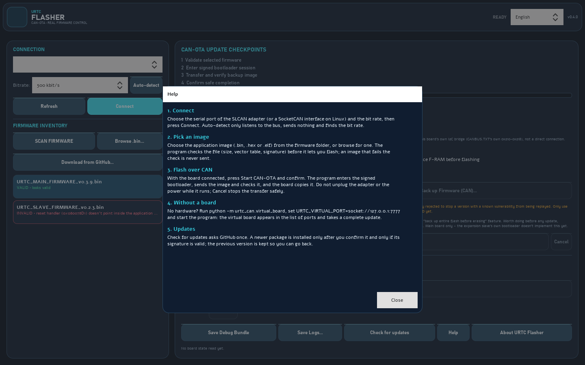
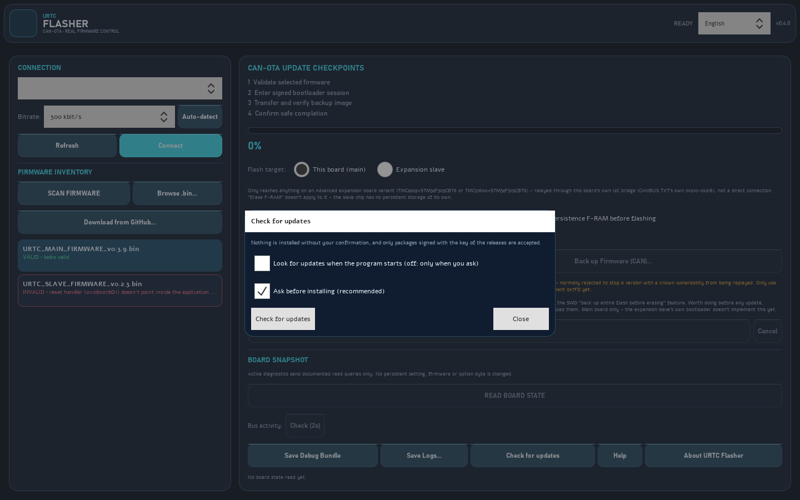

# The window of the flasher, step by step

These pictures are the real window, loaded without a screen and drawn to a file by `tools/capture_screens.py` (`python tools/capture_screens.py` writes them again). They show the program as it opens: nothing is connected, nothing is sent, and the language is English. The same texts exist in the eight languages of the program, and the **Help** button of the window shows the quick guide in the language you chose.

## 1. The window as it opens

* **Connection** (left): choose the serial port of the SLCAN adapter (or a SocketCAN interface on Linux) and the bit rate, then press **Connect**. **Auto-detect** only listens to the bus, sends nothing and finds the bit rate. With no hardware, run `python -m urtc_can.virtual_board`, set `URTC_VIRTUAL_PORT=socket://127.0.0.1:7777` and the virtual board appears in the list of ports.
* **Firmware inventory**: **Scan firmware** reads the `firmware/` folder and checks each image (size, vector table, signature) before it lets you flash; an image that fails the check is marked and never sent.
* **CAN-OTA update checkpoints** (right): the four steps of an update. **Start CAN-OTA** asks for a confirmation, enters the signed bootloader, sends the image and checks it, and the board copies it. Do not unplug the adapter or the power while it runs; **Cancel** stops the transfer safely.
* **Board snapshot**: **Read board state** only reads.

## 2. Help

The **Help** button opens five short steps in the language of the window: connect, pick an image, flash over CAN, without a board, and updates.

## 3. Check for updates

**Check for updates** asks GitHub once, only when you press it. Both options are conservative: the check at start is off, and an update is installed only after you confirm it and only if the signature of the package matches the key of the releases pinned in the program; the previous version is kept so you can go back.

## The same pictures in the other languages

The program has eight interface languages. These are the same three pictures of the flasher taken with each of them (`python tools/capture_screens.py --all-languages` writes them again; `--language german` writes one language). The texts are those of the program, not of this page, so a picture shows exactly what a person who chose that language sees.

| Language | Window | Help | Updates |
|---|---|---|---|
| English | [window](screenshots/flasher-deck.png) | [help](screenshots/flasher-help.png) | [updates](screenshots/flasher-updates.png) |
| Español | [window](screenshots/flasher-deck-es.png) | [help](screenshots/flasher-help-es.png) | [updates](screenshots/flasher-updates-es.png) |
| Deutsch | [window](screenshots/flasher-deck-de.png) | [help](screenshots/flasher-help-de.png) | [updates](screenshots/flasher-updates-de.png) |
| Français | [window](screenshots/flasher-deck-fr.png) | [help](screenshots/flasher-help-fr.png) | [updates](screenshots/flasher-updates-fr.png) |
| Italiano | [window](screenshots/flasher-deck-it.png) | [help](screenshots/flasher-help-it.png) | [updates](screenshots/flasher-updates-it.png) |
| 日本語 | [window](screenshots/flasher-deck-ja.png) | [help](screenshots/flasher-help-ja.png) | [updates](screenshots/flasher-updates-ja.png) |
| 简体中文 | [window](screenshots/flasher-deck-zh.png) | [help](screenshots/flasher-help-zh.png) | [updates](screenshots/flasher-updates-zh.png) |
| Português | [window](screenshots/flasher-deck-pt.png) | [help](screenshots/flasher-help-pt.png) | [updates](screenshots/flasher-updates-pt.png) |

## What the pictures do not show

They do not show a board answering. Nothing in this guide has been run against a real board; the README lists what has and has not been checked.
