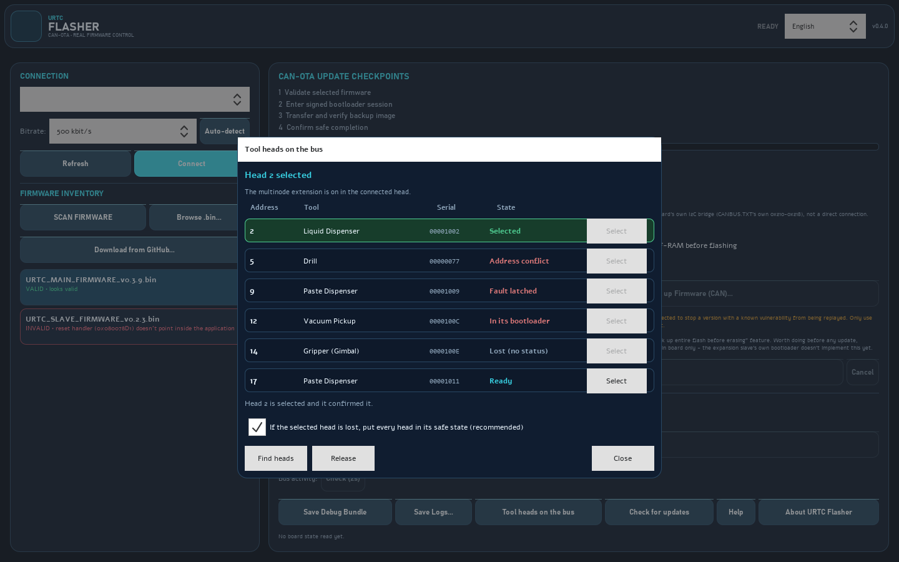

# The window of the flasher, step by step

These pictures are the real window, loaded without a screen and drawn to a file by `tools/capture_screens.py` (`python tools/capture_screens.py` writes them again). They show the program as it opens: nothing is connected, nothing is sent, and the language is English (the picture of the tool heads is the exception: it shows the window over a modelled bus). The same texts exist in the eight languages of the program, and the **Help** button of the window shows the quick guide in the language you chose.

## 1. The window as it opens

* **Connection** (left): choose the serial port of the SLCAN adapter (or a SocketCAN interface on Linux) and the bit rate, then press **Connect**. **Auto-detect** only listens to the bus, sends nothing and finds the bit rate. With no hardware, run `python -m urtc_can.virtual_board`, set `URTC_VIRTUAL_PORT=socket://127.0.0.1:7777` and the virtual board appears in the list of ports.
* **Firmware inventory**: **Scan firmware** reads the `firmware/` folder and checks each image (size, vector table, signature) before it lets you flash; an image that fails the check is marked and never sent.
* **CAN-OTA update checkpoints** (right): the four steps of an update. **Start CAN-OTA** asks for a confirmation, enters the signed bootloader, sends the image and checks it, and the board copies it. Do not unplug the adapter or the power while it runs; **Cancel** stops the transfer safely.
* **Board snapshot**: **Read board state** only reads.

## 2. Help

The **Help** button opens seven short steps in the language of the window: connect, pick an image, flash over CAN, without a board, the history, several heads and updates.

## 3. Check for updates

**Check for updates** asks GitHub once, only when you press it. Both options are conservative: the check at start is off, and an update is installed only after you confirm it and only if the signature of the package matches the key of the releases pinned in the program; the previous version is kept so you can go back.

## 4. Several tool heads

The **Tool heads** button opens the window that finds the heads when more than one shares the bus (the multinode extension of the firmware, which is **off by default**: with it off, **Find heads** finds nobody, the bus counts as one head and everything is sent as it always was). The picture is taken over a modelled bus of seven heads, one in each state a head can be in, so it shows the window and not a real bus:

* Each head has its **address**, its **tool**, its **serial number** and a **state** written in words: *Ready*, *Selected*, *Address conflict* (two boards on one address; neither can be selected), *Fault latched*, *In its bootloader* or *Lost* (no status for too long). Only a ready head has a **Select** button.
* **Select** asks you to confirm. Nothing is sent to a head until it has confirmed that it is selected; while several heads are on the bus, any command to the board is refused until one is selected (the frames of the extension itself are not).
* If the selected head is lost, faults, enters its bootloader or no longer reports itself selected, the window shows why in a banner. By default every head is also put in its safe state, so no output stays on without a host watching it; the checkbox at the bottom switches that off (it asks first, and the banner then says that the outputs were left as they are).
* The line under the title says whether the head reports the extension as on, off, or saved but waiting for the next power-up. This has been tried against a model of the bus only, never against boards.

## 5. History

The **History** button next to **Help** opens the history of operations: the evidence records (`urtc-evidence/1`) that the flasher wrote, newest first, with the kind, the result, the tool, the board and the versions. Each record is checked when the window opens; one that was edited after it was written, a file that is not JSON or a record of another format is shown as **NOT VALID** with what is wrong. You can filter by result and by text, or reduce the list to the records that fail. The window reads the folder again each time it opens (or when you press **Read again**), shows at most 500 rows and says how many there are, and never changes anything on disk. It is the same window, in the eight languages, in the flasher, the tester and the updater.
From the command line, `python urtc_flasher.py --history FOLDER [--json]` gives the same list for a folder (see [CLI_REFERENCE.md](CLI_REFERENCE.md)).

## The same pictures in the other languages

The program has eight interface languages. These are the same four pictures of the flasher taken with each of them (`python tools/capture_screens.py --all-languages` writes them again; `--language german` writes one language). The texts are those of the program, not of this page, so a picture shows exactly what a person who chose that language sees.

| Language | Window | Help | Updates | Tool heads |
|---|---|---|---|---|
| English | [window](screenshots/flasher-deck.png) | [help](screenshots/flasher-help.png) | [updates](screenshots/flasher-updates.png) | [heads](screenshots/flasher-heads.png) |
| Español | [window](screenshots/flasher-deck-es.png) | [help](screenshots/flasher-help-es.png) | [updates](screenshots/flasher-updates-es.png) | [heads](screenshots/flasher-heads-es.png) |
| Deutsch | [window](screenshots/flasher-deck-de.png) | [help](screenshots/flasher-help-de.png) | [updates](screenshots/flasher-updates-de.png) | [heads](screenshots/flasher-heads-de.png) |
| Français | [window](screenshots/flasher-deck-fr.png) | [help](screenshots/flasher-help-fr.png) | [updates](screenshots/flasher-updates-fr.png) | [heads](screenshots/flasher-heads-fr.png) |
| Italiano | [window](screenshots/flasher-deck-it.png) | [help](screenshots/flasher-help-it.png) | [updates](screenshots/flasher-updates-it.png) | [heads](screenshots/flasher-heads-it.png) |
| 日本語 | [window](screenshots/flasher-deck-ja.png) | [help](screenshots/flasher-help-ja.png) | [updates](screenshots/flasher-updates-ja.png) | [heads](screenshots/flasher-heads-ja.png) |
| 简体中文 | [window](screenshots/flasher-deck-zh.png) | [help](screenshots/flasher-help-zh.png) | [updates](screenshots/flasher-updates-zh.png) | [heads](screenshots/flasher-heads-zh.png) |
| Português | [window](screenshots/flasher-deck-pt.png) | [help](screenshots/flasher-help-pt.png) | [updates](screenshots/flasher-updates-pt.png) | [heads](screenshots/flasher-heads-pt.png) |

## What the pictures do not show

They do not show a board answering. Nothing in this guide has been run against a real board; the README lists what has and has not been checked.
